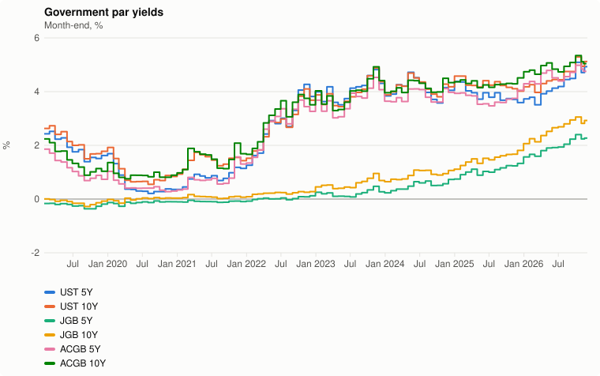
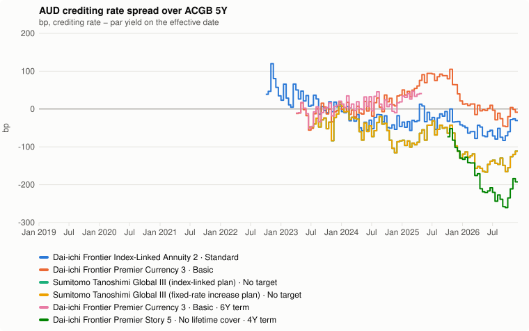
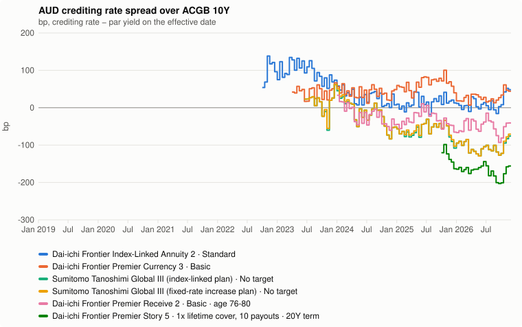
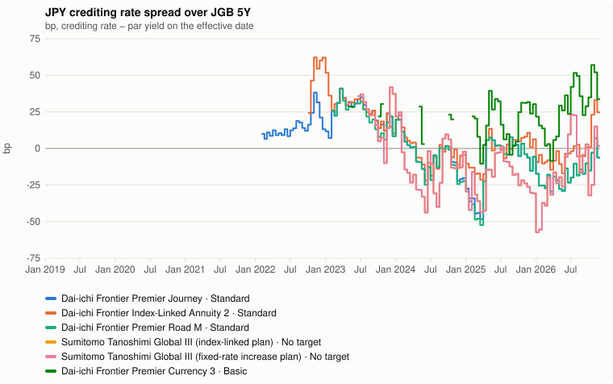
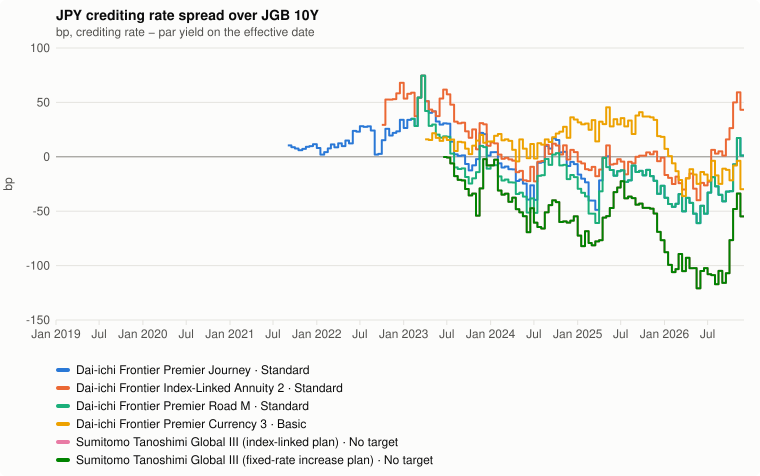
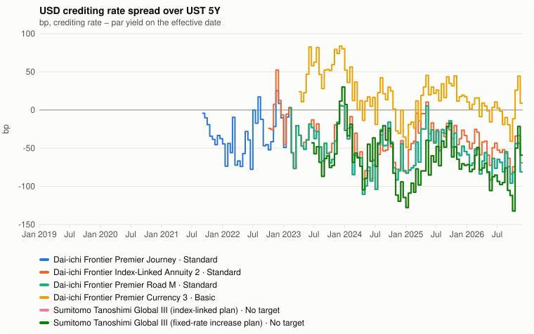
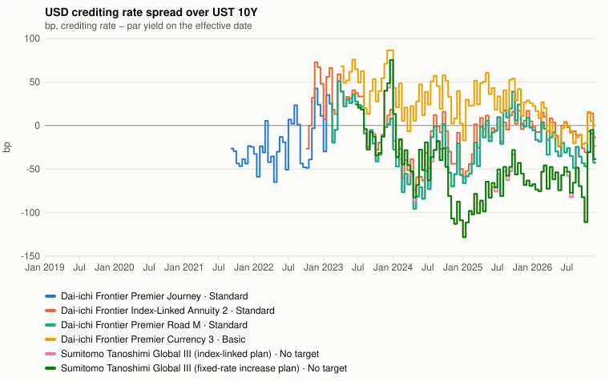
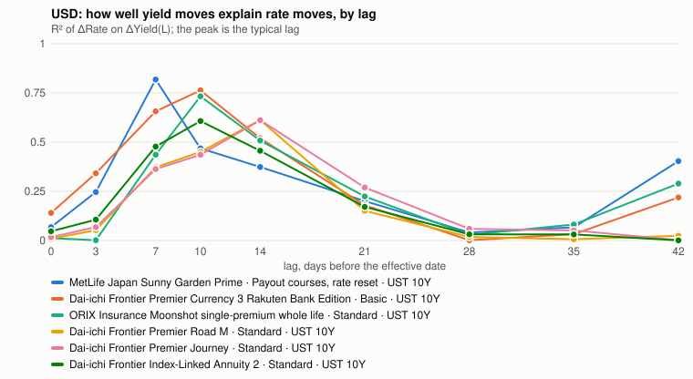
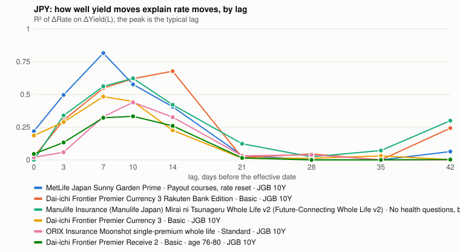
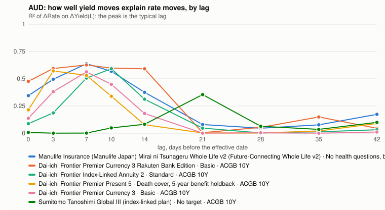

# Rate spreads over government bonds

Generated 2026-11-17 by `scripts/rate_spreads.py` from `data/rates/` and `data/markets/`. Rates in force up to 2026-11-16.

Each crediting rate and net yield is read against the risk-free par yield of the same currency and a matching tenor: **spread = rate − government yield**, in basis points. A positive spread is what the insurer credits above a same-currency government bond bought on the same day, before loads, surrender charges, MVA and FX.

## Headlines

- **USD 5Y, Fixed annuity:** widest crediting-rate spread now is Dai-ichi Frontier Premier Currency 3 Rakuten Bank Edition · Basic at 5.11% (+12 bp over UST 5Y, 4.99% annual effective on 2026-11-16); range across 9 series -165 to +12 bp.
- **USD 5Y, Indexed annuity:** widest crediting-rate spread now is Nippon Wealth Designated-currency rate-linked annuity with index-linked rider II · 20-year payout · age 0-69 at 4.93% (-6 bp over UST 5Y, 4.99% annual effective on 2026-11-16); range across 13 series -106 to -6 bp.
- **USD 5Y, Survival-weighted annuity:** widest crediting-rate spread now is Dai-ichi Frontier Premier Currency 3 Rakuten Bank Edition · Maturity-focused at 5.14% (+15 bp over UST 5Y, 4.99% annual effective on 2026-11-16); range across 11 series -165 to +15 bp.
- **USD 5Y, Whole life, periodic payout:** widest crediting-rate spread now is Dai-ichi Frontier Premier Story 5 · No lifetime cover at 3.5% (-149 bp over UST 5Y, 4.99% annual effective on 2026-11-16); range across 1 series -149 to -149 bp.
- **USD 5Y, Whole life, rate locked or reset:** widest crediting-rate spread now is Manulife Insurance (Manulife Japan) Mirai ni Tsunageru Whole Life v2 (Future-Connecting Whole Life v2) · No health questions, basic course · age 50-54 at 5.89% (+90 bp over UST 5Y, 4.99% annual effective on 2026-11-16); range across 24 series -75 to +90 bp.
- **USD 10Y, Fixed annuity:** widest crediting-rate spread now is Nippon Wealth Yuyu Jikan Advance 2 · USD, 5-year payout · age 0-69 at 5.23% (+4 bp over UST 10Y, 5.19% annual effective on 2026-11-16); range across 23 series -135 to +4 bp.
- **USD 10Y, Indexed annuity:** widest crediting-rate spread now is Nippon Wealth Designated-currency rate-linked annuity with index-linked rider II · 20-year payout · age 0-69 at 5.09% (-10 bp over UST 10Y, 5.19% annual effective on 2026-11-16); range across 13 series -86 to -10 bp.
- **USD 10Y, Survival-weighted annuity:** widest crediting-rate spread now is Mitsui Sumitomo Primary Ashita no Yorokobi 2 (Tomorrow's Joy 2) · Maturity-focused, 100% death cover at 5.36% (+17 bp over UST 10Y, 5.19% annual effective on 2026-11-16); range across 14 series -135 to +17 bp.
- **USD 10Y, Whole life, periodic payout:** widest crediting-rate spread now is Dai-ichi Frontier Premier Receive 2 · Basic · age 0-65 at 5.01% (-18 bp over UST 10Y, 5.19% annual effective on 2026-11-16); range across 21 series -140 to -18 bp.
- **USD 10Y, Whole life, rate locked or reset:** widest crediting-rate spread now is Manulife Insurance (Manulife Japan) Mirai ni Tsunageru Whole Life v2 (Future-Connecting Whole Life v2) · No health questions, basic course · age 50-54 at 5.89% (+70 bp over UST 10Y, 5.19% annual effective on 2026-11-16); range across 43 series -312 to +70 bp.
- **JPY 5Y, Fixed annuity:** widest crediting-rate spread now is Dai-ichi Frontier Premier Currency 3 Rakuten Bank Edition · Basic at 2.64% (+36 bp over JGB 5Y, 2.28% annual effective on 2026-11-16); range across 11 series +2 to +36 bp.
- **JPY 5Y, Indexed annuity:** widest crediting-rate spread now is Dai-ichi Frontier Index-Linked Annuity 2 · Standard at 2.53% (+25 bp over JGB 5Y, 2.28% annual effective on 2026-11-16); range across 4 series -6 to +25 bp.
- **JPY 5Y, Survival-weighted annuity:** widest crediting-rate spread now is Mitsui Sumitomo Primary Ashita no Yorokobi 2 (Tomorrow's Joy 2) · Maturity-focused, 100% death cover at 2.69% (+41 bp over JGB 5Y, 2.28% annual effective on 2026-11-16); range across 10 series -12 to +41 bp.
- **JPY 5Y, Whole life, periodic payout:** widest crediting-rate spread now is Dai-ichi Frontier Premier Story 5 · No lifetime cover at 1.13% (-115 bp over JGB 5Y, 2.28% annual effective on 2026-11-16); range across 2 series -116 to -115 bp.
- **JPY 5Y, Whole life, rate locked or reset:** widest crediting-rate spread now is Manulife Insurance (Manulife Japan) Mirai ni Tsunageru Whole Life v2 (Future-Connecting Whole Life v2) · No health questions, basic course · age 50-54 at 3.87% (+159 bp over JGB 5Y, 2.28% annual effective on 2026-11-16); range across 24 series -27 to +159 bp.
- **JPY 10Y, Fixed annuity:** widest crediting-rate spread now is Nippon Wealth Designated-currency individual annuity · Premium JPY 30m or more · age 0-84 at 3.33% (+38 bp over JGB 10Y, 2.95% annual effective on 2026-11-16); range across 16 series -55 to +38 bp.
- **JPY 10Y, Indexed annuity:** widest crediting-rate spread now is Dai-ichi Frontier Index-Linked Annuity 2 · Standard at 3.38% (+43 bp over JGB 10Y, 2.95% annual effective on 2026-11-16); range across 4 series -55 to +43 bp.
- **JPY 10Y, Survival-weighted annuity:** widest crediting-rate spread now is Nippon Wealth Yuyu Jikan Advance 2 · Survival-weighted (tontine) · age 0-84 at 3.3% (+35 bp over JGB 10Y, 2.95% annual effective on 2026-11-16); range across 15 series -28 to +35 bp.
- **JPY 10Y, Whole life, periodic payout:** widest crediting-rate spread now is Dai-ichi Frontier Premier Receive 2 · Basic · age 0-65 at 2.97% (+2 bp over JGB 10Y, 2.95% annual effective on 2026-11-16); range across 16 series -88 to +2 bp.
- **JPY 10Y, Whole life, rate locked or reset:** widest crediting-rate spread now is Manulife Insurance (Manulife Japan) Mirai ni Tsunageru Whole Life v2 (Future-Connecting Whole Life v2) · No health questions, basic course · age 50-54 at 3.87% (+92 bp over JGB 10Y, 2.95% annual effective on 2026-11-16); range across 19 series -40 to +92 bp.
- **AUD 5Y, Fixed annuity:** widest crediting-rate spread now is Dai-ichi Frontier Premier Currency 3 Rakuten Bank Edition · Basic at 4.76% (-5 bp over ACGB 5Y, 4.81% annual effective on 2026-11-11); range across 17 series -186 to -5 bp.
- **AUD 5Y, Indexed annuity:** widest crediting-rate spread now is Dai-ichi Frontier Index-Linked Annuity 2 · Standard at 4.51% (-30 bp over ACGB 5Y, 4.81% annual effective on 2026-11-11); range across 11 series -186 to -30 bp.
- **AUD 5Y, Survival-weighted annuity:** widest crediting-rate spread now is Mitsui Sumitomo Primary Ashita no Yorokobi 2 (Tomorrow's Joy 2) · Maturity-focused, 100% death cover at 4.94% (+13 bp over ACGB 5Y, 4.81% annual effective on 2026-11-11); range across 17 series -142 to +13 bp.
- **AUD 5Y, Whole life, periodic payout:** widest crediting-rate spread now is Dai-ichi Frontier Premier Story 5 · No lifetime cover at 3% (-181 bp over ACGB 5Y, 4.81% annual effective on 2026-11-11); range across 2 series -192 to -181 bp.
- **AUD 5Y, Whole life, rate locked or reset:** widest crediting-rate spread now is Manulife Insurance (Manulife Japan) Mirai ni Tsunageru Whole Life v2 (Future-Connecting Whole Life v2) · No health questions, basic course · age 50-54 at 5.43% (+62 bp over ACGB 5Y, 4.81% annual effective on 2026-11-11); range across 29 series +32 to +62 bp.
- **AUD 10Y, Fixed annuity:** widest crediting-rate spread now is Dai-ichi Frontier Premier Currency 3 Rakuten Bank Edition · Basic at 5.61% (+50 bp over ACGB 10Y, 5.11% annual effective on 2026-11-11); range across 20 series -191 to +50 bp.
- **AUD 10Y, Indexed annuity:** widest crediting-rate spread now is Dai-ichi Frontier Index-Linked Annuity 2 · Standard at 5.59% (+48 bp over ACGB 10Y, 5.11% annual effective on 2026-11-11); range across 11 series -191 to +48 bp.
- **AUD 10Y, Survival-weighted annuity:** widest crediting-rate spread now is Dai-ichi Frontier Premier Currency 3 Rakuten Bank Edition · Maturity-focused at 5.66% (+55 bp over ACGB 10Y, 5.11% annual effective on 2026-11-11); range across 14 series -139 to +55 bp.
- **AUD 10Y, Whole life, periodic payout:** widest crediting-rate spread now is Dai-ichi Frontier Premier Receive 3 · Standard · age 0-65 at 5.23% (+12 bp over ACGB 10Y, 5.11% annual effective on 2026-11-11); range across 34 series -223 to +12 bp.
- **AUD 10Y, Whole life, rate locked or reset:** widest crediting-rate spread now is Manulife Insurance (Manulife Japan) Mirai ni Tsunageru Whole Life v2 (Future-Connecting Whole Life v2) · No health questions, basic course · age 50-54 at 5.43% (+32 bp over ACGB 10Y, 5.11% annual effective on 2026-11-11); range across 44 series -342 to +32 bp.
- **Dai-ichi Frontier Life, AUD pass-through:** best fit at a lag of about 7 days, beta 0.55 (median R² 0.48 across 19 series).
- **Manulife Life Insurance (Manulife Japan), AUD pass-through:** best fit at a lag of about 7 days, beta 0.46 (median R² 0.40 across 5 series).
- **Sumitomo Life, AUD pass-through:** best fit at a lag of about 21 days, beta 0.30 (median R² 0.35 across 4 series).
- **MetLife Japan, JPY pass-through:** best fit at a lag of about 7 days, beta 1.07 (median R² 0.77 across 2 series).
- **Manulife Life Insurance (Manulife Japan), JPY pass-through:** best fit at a lag of about 10 days, beta 0.74 (median R² 0.37 across 5 series).
- **ORIX Life Insurance, JPY pass-through:** best fit at a lag of about 10 days, beta 0.29 (median R² 0.44 across 1 series).
- **Dai-ichi Frontier Life, USD pass-through:** best fit at a lag of about 14 days, beta 0.58 (median R² 0.47 across 23 series).
- **MetLife Japan, USD pass-through:** best fit at a lag of about 7 days, beta 1.14 (median R² 0.81 across 2 series).
- **ORIX Life Insurance, USD pass-through:** best fit at a lag of about 10 days, beta 0.46 (median R² 0.73 across 1 series).
- **Prudential Gibraltar Financial Life (PGF Life), USD pass-through:** best fit at a lag of about 7 days, beta 0.93 (median R² 0.70 across 2 series).
- **Sumitomo Life, USD pass-through:** best fit at a lag of about 21 days, beta 0.53 (median R² 0.35 across 4 series).
- **No reliable pass-through lag** (yield moves explain little of the rate moves): Dai-ichi Frontier Life JPY (median R² 0.21); Sumitomo Life JPY (median R² 0.03); Manulife Life Insurance (Manulife Japan) USD (median R² 0.30).

## Coverage

| Curve | Source | Tenors kept | From | To |
|---|---|---|---|---|
| UST (USD) | US Treasury daily par yield curve (home.treasury.gov) | 1Y, 2Y, 3Y, 5Y, 7Y, 10Y, 20Y, 30Y | 2019-01-02 | 2026-11-16 |
| JGB (JPY) | MOF Japan JGB par yields (jgbcm_all.csv, jgbcm.csv) | 1Y, 2Y, 3Y, 5Y, 7Y, 10Y, 15Y, 20Y, 30Y | 2019-01-04 | 2026-11-16 |
| ACGB (AUD) | RBA table F2, government bond yields, daily | 2Y, 3Y, 5Y, 10Y | 2019-01-02 | 2026-11-11 |

**Products covered.** 26 of 39 products in `data/products` have at least one matched rate point (9 tracked, 17 candidate).

Products with no matched point, and so not in the tables or charts (their rate points carry no term, are life-annuity or whole-life rates with no single tenor, or are not a crediting rate or net yield): Jibun Nenkin Kaigo Plus [candidate], Premier Partner [candidate], Be With You Plus II [candidate], Foreign-currency Everybody Plus [candidate], Designated-currency special whole life (no-underwriting course) [candidate], Designated-currency special whole life (25) [candidate], Designated-currency whole life (underwritten course) [candidate], Designated-currency special whole life with reserve-segment rider (index-linked) [candidate], Rate-linked whole life (discontinued) [candidate], Designated-currency special whole life with fixed-accumulation reserve-segment rider [candidate], Rate-linked whole life with survival benefit (designated currency) [candidate], Sodateru Kajitsu (single premium) [candidate], Fullheart J-Road Global III [candidate].

**As-of dates.** Latest rate effective date matched: 2026-11-16 (oldest per-product latest: 2026-11-09, Ashita no Yorokobi 2 (Tomorrow's Joy 2)). Latest yield date used: 2026-11-16.

16937 rate points matched to a yield (crediting rate and net yield). Points not matched:

- no term in data: 7324
- life annuity (rate fixed for life, no single tenor): 646
- currency NZD has no tracked curve: 28
- currency EUR has no tracked curve: 6

## Method

- **Yields.** Par yields as published, daily, from 2019. The curve for USD is the Treasury par yield curve (constant maturity, bond-equivalent), JPY is the MOF JGB par yield table, AUD is RBA F2 (yields interpolated by the RBA to constant 2/3/5/10-year maturities). Tenors kept: UST 1/2/3/5/7/10/20/30Y, JGB 1/2/3/5/7/10/15/20/30Y, ACGB 2/3/5/10Y. F2 stops at 10 years, so AUD terms of 15-30 years are matched to ACGB 10Y and their spreads overstate the pick-up wherever the curve slopes up. The RBA publishes F2 a few days in arrears, so the latest AUD points use a yield up to a week old.
- **Tenor of a rate.** The rate point's `term_years` (the product's accumulation or guarantee period). Where the plan has no term column but a period in its name (Nippon Wealth Yuyu Jikan Advance 2 judgement-period plans, e.g. 10–12 years), the midpoint, or the stated bound for open-ended bands (≤5 → 5, ≥11 → 11, 18-to-life → 18). Nippon Wealth's fixed-term payout plans (5/10/20-year payout) store the deferral period as the term, and the rate is fixed through deferral and payout, so their tenor is deferral + half the payout period (roughly the duration of a level annuity). Life-annuity plans and immediate-payout points (term 0) have no single tenor and are left out.
- **Matching.** Same currency; the nearest published curve tenor (a tie goes to the longer). No interpolation along the curve. Yield on the rate's effective date, or the latest business day before it, at most 7 days earlier.
- **Spread** = rate − yield, in bp, on each rate point as stored, with the yield first converted from its published semi-annual basis to annual effective, the basis of a credited rate: (1 + y/2)² − 1. At 5% that adds about 6 bp to the yield, at 2% about 1 bp; `yield_pct` in the CSV is the yield as published and `yield_ae_pct` the converted one. Crediting rates and net yields are both used; net yields (T&D, Dai-ichi Frontier) are after the product's loads and so are the fairer read.
- **Products.** All products in `data/products` are included, tracked and candidate. Candidate products (marked as candidates in the product file, not yet enabled in the app) are labelled “[candidate]” in the tables and charts and have `candidate = true` in the CSV. `--exclude-candidates` leaves them out.
- **Rankings by product type.** Headlines and “richest now” tables are split by product type (`product_type` of the product, or of the plan where it overrides it, as in the app), so a whole-life rate is never ranked against a fixed annuity.
- **Caveats.** Insurers price off swaps, corporate spreads and their own asset mix, so the spread is a measure of competitiveness, not of margin. Spreads on Wayback-derived points (`via_wayback`) are included and flagged in the CSV. Survival-weighted (tontine) and annuity-focused plans can credit a higher rate because part of the value is forfeited on early death or surrender, so their spreads are not like-for-like with plain savings plans.
- **Pass-through.** For each headline series, consecutive effective dates d0 < d1 at most 45 days apart give ΔRate = rate(d1) − rate(d0) and ΔYield(L) = yield(d1 − L) − yield(d0 − L) for lags L = 0, 3, 7, 10, 14, 21, 28, 35, 42 days. ΔRate is regressed on ΔYield(L) by OLS for each lag; the **lag** reported is the one with the highest R², and the **beta** is the slope at that lag (1.0 = full pass-through of a yield move within one rate period). Picking the best of 9 lags flatters R², so a fit with R² below 0.3 is reported as “no reliable lag” and kept out of the headlines. The **level beta** is the slope of the rate on the matched yield across all points; both series trend, so it describes how they moved together and is not an estimate of cause. An insurer's medians pool its headline series, which are often one product at several tenors and so not independent. Series with fewer than 8 comparable period pairs (archive captures on scattered dates, or histories that start in 2024-25) are not estimated.
- **Headline series.** Charts and pass-through use one series per product, currency and curve tenor: the plan with the longest history and the middle age band. All series are in `data/markets/rate_spreads.csv`.

Data: `data/markets/rate_spreads.csv` (one row per rate point: matched tenor, curve, yield date, yield and spread; written by this script and not kept in git, so run it to get the file). Charts are SVG in `reports/rate-spreads/`; the y axis is the spread in bp, steps hold until the next rate, and a line breaks where points are more than 45 days apart.

## The curves

## Spread over time

Crediting rate minus the matched government yield, one headline series per product. Charts for the 5Y and 10Y points of each curve; other tenors (short USD deferrals, JPY 15-30Y) are in the CSV and the tables below.

### AUD against ACGB 5Y

### AUD against ACGB 10Y

### JPY against JGB 5Y

### JPY against JGB 10Y

### USD against UST 5Y

### USD against UST 10Y

## Pass-through of yield moves

One row per headline crediting-rate series with at least 8 period-to-period comparisons. Lag = days between the yield move and the effective date that fits best; beta = share of a yield move passed into the rate at that lag; R² of that fit; level beta = long-run slope of rate on yield; moves = periods in which the rate changed.

| Product · plan | Ccy | Curve | Pairs | Moves | Best lag (d) | Beta | R² | Beta at lag 14 d | Level beta |
|---|---|---|---|---|---|---|---|---|---|
| Manulife Insurance (Manulife Japan) Mirai ni Tsunageru Whole Life v2 (Future-Connecting Whole Life v2) · No health questions, basic course · age 60-64 | AUD | ACGB 2Y | 12 | 12 | none | – | 0.28 | 0.46 | 0.60 |
| Dai-ichi Frontier Premier Currency 3 · Basic | AUD | ACGB 3Y | 49 | 38 | 7 | 0.56 | 0.69 | 0.30 | 0.79 |
| Manulife Insurance (Manulife Japan) Mirai ni Tsunageru Whole Life v2 (Future-Connecting Whole Life v2) · No health questions, basic course · age 55-59 | AUD | ACGB 3Y | 12 | 12 | 7 | 0.39 | 0.31 | 0.47 | 0.62 |
| Dai-ichi Frontier Premier Currency 3 Rakuten Bank Edition · Basic | AUD | ACGB 5Y | 12 | 9 | 10 | 1.04 | 0.79 | 0.75 | 0.60 |
| Dai-ichi Frontier Premier Currency 3 · Basic · 6Y term | AUD | ACGB 5Y | 49 | 47 | 7 | 0.69 | 0.68 | 0.38 | 0.97 |
| Dai-ichi Frontier Index-Linked Annuity 2 · Standard | AUD | ACGB 5Y | 99 | 85 | 10 | 0.77 | 0.62 | 0.50 | 0.42 |
| Dai-ichi Frontier Premier Currency 3 · Basic | AUD | ACGB 5Y | 87 | 74 | 7 | 0.60 | 0.55 | 0.33 | 0.63 |
| Manulife Insurance (Manulife Japan) Mirai ni Tsunageru Whole Life v2 (Future-Connecting Whole Life v2) · No health questions, basic course · age 55-59 | AUD | ACGB 5Y | 12 | 12 | 7 | 0.46 | 0.40 | 0.51 | 0.65 |
| Manulife Insurance (Manulife Japan) Mirai ni Tsunageru Whole Life v2 (Future-Connecting Whole Life v2) · No health questions, basic course · age 50-54 · 7Y term | AUD | ACGB 5Y | 12 | 12 | 7 | 0.46 | 0.40 | 0.51 | 0.65 |
| Sumitomo Tanoshimi Global III (index-linked plan) · No target | AUD | ACGB 5Y | 82 | 22 | 21 | 0.29 | 0.35 | 0.09 | 0.08 |
| Sumitomo Tanoshimi Global III (fixed-rate increase plan) · No target | AUD | ACGB 5Y | 82 | 22 | 21 | 0.29 | 0.35 | 0.09 | 0.08 |
| Dai-ichi Frontier Premier Story 5 · No lifetime cover · 6Y term | AUD | ACGB 5Y | 27 | 17 | 10 | 0.52 | 0.33 | 0.18 | -0.08 |
| Dai-ichi Frontier Premier Story 5 · No lifetime cover · 4Y term | AUD | ACGB 5Y | 27 | 16 | none | – | 0.26 | 0.11 | -0.35 |
| Manulife Insurance (Manulife Japan) Mirai ni Tsunageru Whole Life v2 (Future-Connecting Whole Life v2) · No health questions, basic course · age 45-49 | AUD | ACGB 10Y | 12 | 12 | 7 | 0.65 | 0.64 | 0.60 | 0.73 |
| Dai-ichi Frontier Premier Currency 3 Rakuten Bank Edition · Basic | AUD | ACGB 10Y | 12 | 10 | 7 | 0.88 | 0.63 | 1.03 | 1.30 |
| Dai-ichi Frontier Index-Linked Annuity 2 · Standard | AUD | ACGB 10Y | 99 | 87 | 10 | 0.77 | 0.59 | 0.52 | 0.39 |
| Dai-ichi Frontier Premier Present 5 · Death cover, 5-year benefit holdback | AUD | ACGB 10Y | 23 | 17 | 3 | 0.67 | 0.57 | 0.27 | 0.40 |
| Dai-ichi Frontier Premier Currency 3 · Basic | AUD | ACGB 10Y | 87 | 76 | 7 | 0.66 | 0.56 | 0.33 | 0.83 |
| Dai-ichi Frontier Premier Present 5 · Dementia and care, health declared · 20Y term | AUD | ACGB 10Y | 23 | 16 | 7 | 0.55 | 0.48 | 0.16 | 0.57 |
| Sumitomo Tanoshimi Global III (index-linked plan) · No target | AUD | ACGB 10Y | 82 | 23 | 21 | 0.32 | 0.35 | 0.14 | -0.08 |
| Sumitomo Tanoshimi Global III (fixed-rate increase plan) · No target | AUD | ACGB 10Y | 82 | 23 | 21 | 0.30 | 0.35 | 0.13 | -0.07 |
| Dai-ichi Frontier Premier Receive 2 · Basic · age 76-80 | AUD | ACGB 10Y | 69 | 50 | none | – | 0.25 | 0.34 | 0.54 |
| Dai-ichi Frontier Premier Story 5 · No lifetime cover · 19Y term | AUD | ACGB 10Y | 27 | 16 | none | – | 0.24 | -0.01 | 0.38 |
| Dai-ichi Frontier Premier Story 5 · No lifetime cover · 24Y term | AUD | ACGB 10Y | 27 | 16 | none | – | 0.24 | -0.01 | 0.38 |
| Dai-ichi Frontier Premier Story 5 · No lifetime cover · 9Y term | AUD | ACGB 10Y | 27 | 18 | none | – | 0.24 | 0.05 | 0.35 |
| Dai-ichi Frontier Premier Story 5 · 1x lifetime cover, 10 payouts · 20Y term | AUD | ACGB 10Y | 27 | 18 | none | – | 0.24 | 0.05 | 0.35 |
| Dai-ichi Frontier Premier Story 5 · No lifetime cover · 29Y term | AUD | ACGB 10Y | 27 | 16 | none | – | 0.24 | -0.00 | 0.38 |
| Dai-ichi Frontier Premier Story 5 · No lifetime cover · 14Y term | AUD | ACGB 10Y | 27 | 18 | none | – | 0.24 | 0.05 | 0.35 |
| Manulife Insurance (Manulife Japan) Mirai ni Tsunageru Whole Life v2 (Future-Connecting Whole Life v2) · No health questions, basic course · age 60-64 | JPY | JGB 2Y | 12 | 11 | none | – | 0.10 | 0.21 | 0.61 |
| Manulife Insurance (Manulife Japan) Mirai ni Tsunageru Whole Life v2 (Future-Connecting Whole Life v2) · No health questions, basic course · age 55-59 | JPY | JGB 3Y | 12 | 11 | none | – | 0.11 | 0.26 | 0.62 |
| MetLife Japan Sunny Garden Prime · Payout courses, rate reset | JPY | JGB 5Y | 15 | 15 | 7 | 1.16 | 0.72 | 0.58 | 0.94 |
| Dai-ichi Frontier Premier Currency 3 Rakuten Bank Edition · Basic | JPY | JGB 5Y | 12 | 10 | 7 | 0.90 | 0.39 | 0.65 | 0.95 |
| Manulife Insurance (Manulife Japan) Mirai ni Tsunageru Whole Life v2 (Future-Connecting Whole Life v2) · No health questions, basic course · age 55-59 | JPY | JGB 5Y | 12 | 11 | 7 | 0.89 | 0.37 | 0.61 | 0.78 |
| Dai-ichi Frontier Premier Currency 3 · Basic | JPY | JGB 5Y | 47 | 42 | none | – | 0.28 | 0.24 | 1.07 |
| Dai-ichi Frontier Index-Linked Annuity 2 · Standard | JPY | JGB 5Y | 99 | 64 | none | – | 0.26 | 0.28 | 0.86 |
| Dai-ichi Frontier Premier Road M · Standard | JPY | JGB 5Y | 91 | 45 | none | – | 0.20 | 0.37 | 0.82 |
| Dai-ichi Frontier Premier Journey · Standard | JPY | JGB 5Y | 115 | 63 | none | – | 0.19 | 0.37 | 0.81 |
| Dai-ichi Frontier Premier Story 5 · No lifetime cover | JPY | JGB 5Y | 27 | 15 | none | – | 0.07 | 0.02 | 0.70 |
| Dai-ichi Frontier Premier Story 5 · No lifetime cover · 4Y term | JPY | JGB 5Y | 27 | 16 | none | – | 0.05 | 0.02 | 0.76 |
| Sumitomo Tanoshimi Global III (index-linked plan) · No target | JPY | JGB 5Y | 82 | 41 | none | – | 0.02 | 0.16 | 0.89 |
| Sumitomo Tanoshimi Global III (fixed-rate increase plan) · No target | JPY | JGB 5Y | 82 | 41 | none | – | 0.02 | 0.16 | 0.89 |
| Manulife Insurance (Manulife Japan) Mirai ni Tsunageru Whole Life v2 (Future-Connecting Whole Life v2) · No health questions, basic course · age 50-54 | JPY | JGB 7Y | 12 | 11 | 7 | 0.88 | 0.52 | 0.64 | 0.89 |
| Dai-ichi Frontier Premier Story 5 · No lifetime cover | JPY | JGB 7Y | 27 | 14 | none | – | 0.08 | 0.06 | 0.57 |
| Dai-ichi Frontier Premier Story 5 · No lifetime cover · 6Y term | JPY | JGB 7Y | 27 | 14 | none | – | 0.08 | 0.04 | 0.59 |
| Dai-ichi Frontier Premier Story 5 · No lifetime cover · 8Y term | JPY | JGB 7Y | 27 | 14 | none | – | 0.07 | 0.06 | 0.64 |
| MetLife Japan Sunny Garden Prime · Payout courses, rate reset | JPY | JGB 10Y | 15 | 15 | 7 | 0.99 | 0.82 | 0.67 | 1.11 |
| Dai-ichi Frontier Premier Currency 3 Rakuten Bank Edition · Basic | JPY | JGB 10Y | 12 | 6 | 14 | 0.84 | 0.68 | 0.84 | 0.84 |
| Manulife Insurance (Manulife Japan) Mirai ni Tsunageru Whole Life v2 (Future-Connecting Whole Life v2) · No health questions, basic course · age 45-49 | JPY | JGB 10Y | 12 | 11 | 10 | 0.74 | 0.62 | 0.66 | 0.93 |
| Dai-ichi Frontier Premier Currency 3 · Basic | JPY | JGB 10Y | 87 | 63 | 7 | 0.72 | 0.48 | 0.52 | 0.86 |
| ORIX Insurance Moonshot single-premium whole life · Standard | JPY | JGB 10Y | 17 | 13 | 10 | 0.29 | 0.44 | 0.33 | 0.72 |
| Dai-ichi Frontier Premier Receive 2 · Basic · age 76-80 | JPY | JGB 10Y | 69 | 58 | 10 | 0.49 | 0.33 | 0.49 | 1.03 |
| Dai-ichi Frontier Index-Linked Annuity 2 · Standard | JPY | JGB 10Y | 99 | 79 | none | – | 0.25 | 0.42 | 0.83 |
| Dai-ichi Frontier Premier Story 5 · No lifetime cover · 9Y term | JPY | JGB 10Y | 27 | 24 | none | – | 0.22 | 0.10 | 0.83 |
| Dai-ichi Frontier Premier Road M · Standard | JPY | JGB 10Y | 91 | 59 | none | – | 0.21 | 0.48 | 0.83 |
| Dai-ichi Frontier Premier Journey · Standard | JPY | JGB 10Y | 125 | 75 | none | – | 0.20 | 0.45 | 0.78 |
| Sumitomo Tanoshimi Global III (index-linked plan) · No target | JPY | JGB 10Y | 82 | 25 | none | – | 0.04 | 0.12 | 0.69 |
| Sumitomo Tanoshimi Global III (fixed-rate increase plan) · No target | JPY | JGB 10Y | 82 | 25 | none | – | 0.04 | 0.12 | 0.69 |
| Dai-ichi Frontier Premier Currency 3 · Basic | JPY | JGB 15Y | 87 | 64 | 7 | 0.65 | 0.54 | 0.43 | 0.81 |
| Dai-ichi Frontier Premier Present 5 · Dementia and care, health declared | JPY | JGB 15Y | 23 | 20 | 42 | -0.50 | 0.32 | 0.29 | 0.69 |
| Dai-ichi Frontier Premier Story 5 · No lifetime cover · 14Y term | JPY | JGB 15Y | 27 | 24 | none | – | 0.14 | 0.04 | 0.84 |
| Dai-ichi Frontier Premier Currency 3 · Basic | JPY | JGB 20Y | 87 | 68 | 7 | 0.63 | 0.61 | 0.36 | 0.85 |
| Dai-ichi Frontier Premier Story 5 · 1x lifetime cover, 10 payouts | JPY | JGB 20Y | 27 | 24 | none | – | 0.24 | 0.10 | 0.89 |
| Dai-ichi Frontier Premier Story 5 · No lifetime cover · 24Y term | JPY | JGB 20Y | 27 | 24 | none | – | 0.11 | 0.02 | 0.88 |
| Dai-ichi Frontier Premier Story 5 · No lifetime cover · 19Y term | JPY | JGB 20Y | 27 | 24 | none | – | 0.10 | 0.02 | 0.89 |
| Dai-ichi Frontier Premier Present 5 · Dementia and care, health declared | JPY | JGB 30Y | 23 | 18 | none | – | 0.24 | 0.23 | 1.21 |
| Dai-ichi Frontier Premier Story 5 · No lifetime cover · 29Y term | JPY | JGB 30Y | 27 | 23 | none | – | 0.10 | 0.04 | 1.07 |
| Manulife Insurance (Manulife Japan) Mirai ni Tsunageru Whole Life v2 (Future-Connecting Whole Life v2) · No health questions, basic course · age 60-64 | USD | UST 2Y | 12 | 12 | none | – | 0.15 | 0.21 | 0.80 |
| Dai-ichi Frontier Premier Currency 3 · Basic | USD | UST 3Y | 49 | 43 | 7 | 0.66 | 0.59 | 0.49 | 0.95 |
| Manulife Insurance (Manulife Japan) Mirai ni Tsunageru Whole Life v2 (Future-Connecting Whole Life v2) · No health questions, basic course · age 55-59 | USD | UST 3Y | 12 | 12 | none | – | 0.17 | 0.24 | 0.76 |
| Dai-ichi Frontier Premier Currency 3 · Basic | USD | UST 5Y | 87 | 71 | 7 | 0.67 | 0.57 | 0.53 | 0.82 |
| Dai-ichi Frontier Premier Currency 3 Rakuten Bank Edition · Basic | USD | UST 5Y | 12 | 6 | 10 | 0.73 | 0.56 | 0.65 | 0.98 |
| Dai-ichi Frontier Index-Linked Annuity 2 · Standard | USD | UST 5Y | 99 | 81 | 10 | 0.58 | 0.55 | 0.46 | 0.65 |
| Dai-ichi Frontier Premier Journey · Standard | USD | UST 5Y | 125 | 85 | 14 | 0.46 | 0.47 | 0.46 | 0.90 |
| Dai-ichi Frontier Premier Road M · Standard | USD | UST 5Y | 91 | 65 | 14 | 0.45 | 0.44 | 0.45 | 0.63 |
| Sumitomo Tanoshimi Global III (index-linked plan) · No target | USD | UST 5Y | 82 | 46 | 21 | 0.49 | 0.34 | 0.27 | 0.66 |
| Sumitomo Tanoshimi Global III (fixed-rate increase plan) · No target | USD | UST 5Y | 82 | 46 | 21 | 0.49 | 0.34 | 0.27 | 0.66 |
| Manulife Insurance (Manulife Japan) Mirai ni Tsunageru Whole Life v2 (Future-Connecting Whole Life v2) · No health questions, basic course · age 55-59 | USD | UST 5Y | 12 | 12 | none | – | 0.30 | 0.32 | 0.78 |
| Dai-ichi Frontier Premier Story 5 · No lifetime cover · 4Y term | USD | UST 5Y | 27 | 25 | none | – | 0.17 | 0.11 | 0.53 |
| Dai-ichi Frontier Premier Currency 3 · Basic · 6Y term | USD | UST 7Y | 49 | 44 | 7 | 0.71 | 0.61 | 0.51 | 0.67 |
| Manulife Insurance (Manulife Japan) Mirai ni Tsunageru Whole Life v2 (Future-Connecting Whole Life v2) · No health questions, basic course · age 50-54 | USD | UST 7Y | 12 | 12 | 10 | 0.40 | 0.45 | 0.37 | 0.83 |
| Dai-ichi Frontier Premier Story 5 · No lifetime cover · 6Y term | USD | UST 7Y | 27 | 26 | none | – | 0.13 | 0.08 | 0.56 |
| MetLife Japan Sunny Garden Prime · Payout courses, rate reset | USD | UST 10Y | 15 | 14 | 7 | 1.10 | 0.82 | 0.73 | 0.65 |
| Dai-ichi Frontier Premier Currency 3 Rakuten Bank Edition · Basic | USD | UST 10Y | 12 | 10 | 10 | 0.73 | 0.76 | 0.60 | 0.87 |
| ORIX Insurance Moonshot single-premium whole life · Standard | USD | UST 10Y | 17 | 14 | 10 | 0.46 | 0.73 | 0.43 | 0.64 |
| Dai-ichi Frontier Premier Road M · Standard | USD | UST 10Y | 91 | 70 | 14 | 0.58 | 0.61 | 0.58 | 0.51 |
| Dai-ichi Frontier Premier Journey · Standard | USD | UST 10Y | 125 | 91 | 14 | 0.58 | 0.61 | 0.58 | 0.97 |
| Dai-ichi Frontier Index-Linked Annuity 2 · Standard | USD | UST 10Y | 99 | 80 | 10 | 0.58 | 0.61 | 0.47 | 0.52 |
| Dai-ichi Frontier Premier Present 5 · Dementia and care, health declared | USD | UST 10Y | 23 | 16 | 7 | 0.66 | 0.60 | 0.41 | 0.62 |
| Manulife Insurance (Manulife Japan) Mirai ni Tsunageru Whole Life v2 (Future-Connecting Whole Life v2) · No health questions, basic course · age 45-49 | USD | UST 10Y | 12 | 12 | 10 | 0.47 | 0.60 | 0.41 | 0.89 |
| Dai-ichi Frontier Premier Currency 3 · Basic | USD | UST 10Y | 87 | 81 | 7 | 0.65 | 0.44 | 0.53 | 0.54 |
| Dai-ichi Frontier Premier Receive 2 · Basic · age 76-80 | USD | UST 10Y | 69 | 63 | 14 | 0.56 | 0.42 | 0.56 | 0.87 |
| Sumitomo Tanoshimi Global III (fixed-rate increase plan) · No target | USD | UST 10Y | 82 | 51 | 21 | 0.57 | 0.36 | 0.40 | 0.56 |
| Sumitomo Tanoshimi Global III (index-linked plan) · No target | USD | UST 10Y | 82 | 49 | 21 | 0.57 | 0.36 | 0.38 | 0.56 |
| Dai-ichi Frontier Premier Story 5 · No lifetime cover · 14Y term | USD | UST 10Y | 27 | 26 | none | – | 0.16 | 0.12 | 0.55 |
| Dai-ichi Frontier Premier Story 5 · No lifetime cover · 9Y term | USD | UST 10Y | 27 | 26 | none | – | 0.12 | 0.12 | 0.65 |
| MetLife Japan Sunny Garden Prime · Payout courses, rate reset | USD | UST 20Y | 15 | 15 | 7 | 1.19 | 0.79 | 0.64 | 0.63 |
| Prudential Gibraltar (PGF) Hosho Sentaku-gata Shushin Hoken Neo (USD) · No withdrawal rider · age 80-90 · 15Y term | USD | UST 20Y | 47 | 43 | 7 | 0.99 | 0.74 | 0.38 | 0.81 |
| Prudential Gibraltar (PGF) Hosho Sentaku-gata Shushin Hoken Neo (USD) · No withdrawal rider · age 15-79 | USD | UST 20Y | 47 | 42 | 7 | 0.87 | 0.65 | 0.34 | 1.08 |
| Dai-ichi Frontier Premier Story 5 · No lifetime cover · 24Y term | USD | UST 20Y | 27 | 26 | none | – | 0.15 | 0.11 | 0.62 |
| Dai-ichi Frontier Premier Story 5 · No lifetime cover · 19Y term | USD | UST 20Y | 27 | 26 | none | – | 0.15 | 0.11 | 0.62 |
| Dai-ichi Frontier Premier Story 5 · 1x lifetime cover, 10 payouts | USD | UST 20Y | 27 | 26 | none | – | 0.14 | 0.12 | 0.77 |
| Dai-ichi Frontier Premier Present 5 · Dementia and care, health declared | USD | UST 30Y | 23 | 16 | 7 | 0.92 | 0.64 | 0.67 | 1.36 |
| Dai-ichi Frontier Premier Story 5 · No lifetime cover · 29Y term | USD | UST 30Y | 27 | 26 | none | – | 0.13 | 0.14 | 0.68 |

By insurer and currency (median across that insurer's headline series, weighted equally):

| Insurer | Ccy | Series | Median best lag (d) | Median beta | Median R² | Median level beta |
|---|---|---|---|---|---|---|
| Dai-ichi Frontier Life | AUD | 19 | 7 | 0.55 | 0.48 | 0.40 |
| Manulife Life Insurance (Manulife Japan) | AUD | 5 | 7 | 0.46 | 0.40 | 0.65 |
| Sumitomo Life | AUD | 4 | 21 | 0.30 | 0.35 | 0.00 |
| Dai-ichi Frontier Life | JPY | 26 | no reliable lag | – | 0.21 | 0.84 |
| MetLife Japan | JPY | 2 | 7 | 1.07 | 0.77 | 1.02 |
| Manulife Life Insurance (Manulife Japan) | JPY | 5 | 10 | 0.74 | 0.37 | 0.78 |
| ORIX Life Insurance | JPY | 1 | 10 | 0.29 | 0.44 | 0.72 |
| Sumitomo Life | JPY | 4 | no reliable lag | – | 0.03 | 0.79 |
| Dai-ichi Frontier Life | USD | 23 | 14 | 0.58 | 0.47 | 0.65 |
| MetLife Japan | USD | 2 | 7 | 1.14 | 0.81 | 0.64 |
| Manulife Life Insurance (Manulife Japan) | USD | 5 | no reliable lag | – | 0.30 | 0.80 |
| ORIX Life Insurance | USD | 1 | 10 | 0.46 | 0.73 | 0.64 |
| Prudential Gibraltar Financial Life (PGF Life) | USD | 2 | 7 | 0.93 | 0.70 | 0.95 |
| Sumitomo Life | USD | 4 | 21 | 0.53 | 0.35 | 0.61 |

## Richest against the curve now

Each series' latest rate (effective within 31 days of 2026-11-16), all read against **one yield per curve and tenor**: the latest published on or before 2026-11-16 (shown above each table), so every row in a table is compared with the same bond. Percentile = where that spread sits in the series' own history of spreads at its effective dates (100 = widest ever).

### Crediting rate

**AUD vs ACGB 2Y, Survival-weighted annuity** (yield 4.808% on 2026-11-11, 4.87% annual effective)

| # | Product · plan | Term | Rate % | Spread bp | Effective | Own-history percentile |
|---|---|---|---|---|---|---|
| 1 | T&D Five-Ten World 4 · FX, no guarantee rider | 2 | 3.6 | -127 | 2026-11-16 | 29 (n=7) |
| 2 | T&D Five-Ten World 4 · FX, guarantee rider | 2 | 3.33 | -154 | 2026-11-16 | 29 (n=7) |

**AUD vs ACGB 2Y, Whole life, rate locked or reset** (yield 4.808% on 2026-11-11, 4.87% annual effective)

| # | Product · plan | Term | Rate % | Spread bp | Effective | Own-history percentile |
|---|---|---|---|---|---|---|
| 1 | Manulife Insurance (Manulife Japan) Mirai ni Tsunageru Whole Life v2 (Future-Connecting Whole Life v2) · No health questions, basic course · age 50-54 | 2 | 5.43 | +56 | 2026-11-16 | 8 (n=13) |
| 2 | Manulife Insurance (Manulife Japan) Mirai ni Tsunageru Whole Life v2 (Future-Connecting Whole Life v2) · No health questions, receipt course · age 50-54 | 2 | 5.33 | +46 | 2026-11-16 | 15 (n=13) |

**AUD vs ACGB 3Y, Fixed annuity** (yield 4.733% on 2026-11-11, 4.79% annual effective)

| # | Product · plan | Term | Rate % | Spread bp | Effective | Own-history percentile |
|---|---|---|---|---|---|---|
| 1 | Mitsui Sumitomo Primary Ashita no Yorokobi 2 (Tomorrow's Joy 2) · Accumulation | 3 | 3.54 | -125 | 2026-11-09 | n=3 |
| 2 | Mitsui Sumitomo Primary Broadway World III · Target (new business stopped) | 3 | 3.54 | -125 | 2026-11-09 | n=3 |

**AUD vs ACGB 3Y, Survival-weighted annuity** (yield 4.733% on 2026-11-11, 4.79% annual effective)

| # | Product · plan | Term | Rate % | Spread bp | Effective | Own-history percentile |
|---|---|---|---|---|---|---|
| 1 | Nippon Wealth Yuyu Jikan Advance 2 · Survival-weighted (tontine) · age 0-84 | 3 | 3.95 | -84 | 2026-11-16 | 25 (n=16) |

**AUD vs ACGB 3Y, Whole life, rate locked or reset** (yield 4.733% on 2026-11-11, 4.79% annual effective)

| # | Product · plan | Term | Rate % | Spread bp | Effective | Own-history percentile |
|---|---|---|---|---|---|---|
| 1 | Manulife Insurance (Manulife Japan) Mirai ni Tsunageru Whole Life v2 (Future-Connecting Whole Life v2) · No health questions, basic course · age 50-54 | 3 | 5.43 | +64 | 2026-11-16 | 0 (n=13) |

**AUD vs ACGB 5Y, Fixed annuity** (yield 4.757% on 2026-11-11, 4.81% annual effective)

| # | Product · plan | Term | Rate % | Spread bp | Effective | Own-history percentile |
|---|---|---|---|---|---|---|
| 1 | Dai-ichi Frontier Premier Currency 3 Rakuten Bank Edition · Basic | 5 | 4.76 | -5 | 2026-11-16 | 54 (n=13) |
| 2 | Dai-ichi Frontier Premier Currency 3 · Basic | 5 | 4.73 | -8 | 2026-11-16 | 25 (n=88) |
| 3 | Nippon Wealth Yuyu Jikan Advance 2 · AUD fixed-term, 6–7 years · age 0-69 | 6.5 (6.5 used) | 4.64 | -17 | 2026-11-16 | 31 (n=16) |
| 4 | Nippon Wealth Yuyu Jikan Advance 2 · AUD fixed-term, up to 5 years · age 0-69 | 5 (5 used) | 4.54 | -27 | 2026-11-16 | 38 (n=16) |
| 5 | Nippon Wealth Designated-currency individual annuity · All premium sizes · age 0-84 | 5 | 4.27 | -54 | 2026-11-16 | 36 (n=14) |
| 6 | Mitsui Sumitomo Primary Ashita no Yorokobi 2 (Tomorrow's Joy 2) · Accumulation | 7 | 4.24 | -57 | 2026-11-09 | n=3 |
| 7 | Mitsui Sumitomo Primary Ashita no Yorokobi 2 (Tomorrow's Joy 2) · Accumulation | 6 | 4.04 | -77 | 2026-11-09 | n=3 |
| 8 | Mitsui Sumitomo Primary Ashita no Yorokobi 2 (Tomorrow's Joy 2) · Accumulation | 5 | 3.94 | -87 | 2026-11-09 | n=3 |
| 9 | Mitsui Sumitomo Primary Broadway World III · Target (new business stopped) | 5 | 3.94 | -87 | 2026-11-09 | n=3 |
| 10 | Mitsui Sumitomo Primary MARE III · Accumulation | 5 | 3.94 | -87 | 2026-11-09 | n=4 |

4 more in the CSV.

**AUD vs ACGB 5Y, Indexed annuity** (yield 4.757% on 2026-11-11, 4.81% annual effective)

| # | Product · plan | Term | Rate % | Spread bp | Effective | Own-history percentile |
|---|---|---|---|---|---|---|
| 1 | Dai-ichi Frontier Index-Linked Annuity 2 · Standard | 5 | 4.51 | -30 | 2026-11-16 | 46 (n=100) |
| 2 | Nippon Wealth Designated-currency rate-linked annuity with index-linked rider II · 20-year payout · age 0-69 | 5 | 4.47 | -34 | 2026-11-16 | 13 (n=15) |
| 3 | Nippon Wealth Designated-currency rate-linked annuity with index-linked rider II · 10-year payout · age 0-69 | 5 | 4.28 | -53 | 2026-11-16 | 13 (n=15) |
| 4 | Nippon Wealth Designated-currency annuity with index-linked rider · All contracts · age 0-84 | 5 | 4.21 | -60 | 2026-11-16 | 33 (n=15) |
| 5 | Sumitomo Tanoshimi Global III (index-linked plan) · No target | 5 | 3.7 | -111 | 2026-11-16 | 30 (n=83) |
| 6 | Sumitomo Tanoshimi Global III (index-linked plan) · With target | 5 | 2.95 | -186 | 2026-11-16 | 10 (n=83) |

**AUD vs ACGB 5Y, Survival-weighted annuity** (yield 4.757% on 2026-11-11, 4.81% annual effective)

| # | Product · plan | Term | Rate % | Spread bp | Effective | Own-history percentile |
|---|---|---|---|---|---|---|
| 1 | Mitsui Sumitomo Primary Ashita no Yorokobi 2 (Tomorrow's Joy 2) · Maturity-focused, 100% death cover | 7 | 4.94 | +13 | 2026-11-09 | n=3 |
| 2 | Mitsui Sumitomo Primary Ashita no Yorokobi 2 (Tomorrow's Joy 2) · Maturity-focused, 50% death cover | 7 | 4.94 | +13 | 2026-11-09 | n=3 |
| 3 | Mitsui Sumitomo Primary Ashita no Yorokobi 2 (Tomorrow's Joy 2) · Maturity-focused, 70% death cover | 7 | 4.94 | +13 | 2026-11-09 | n=3 |
| 4 | Dai-ichi Frontier Premier Currency 3 Rakuten Bank Edition · Maturity-focused | 5 | 4.81 | +0 | 2026-11-16 | 54 (n=13) |
| 5 | Dai-ichi Frontier Premier Currency 3 · Maturity-focused, 100% death benefit | 5 | 4.78 | -3 | 2026-11-16 | 14 (n=88) |
| 6 | Mitsui Sumitomo Primary Ashita no Yorokobi 2 (Tomorrow's Joy 2) · Maturity-focused, 100% death cover | 6 | 4.74 | -7 | 2026-11-09 | n=3 |
| 7 | Mitsui Sumitomo Primary Ashita no Yorokobi 2 (Tomorrow's Joy 2) · Maturity-focused, 50% death cover | 6 | 4.74 | -7 | 2026-11-09 | n=3 |
| 8 | Mitsui Sumitomo Primary Ashita no Yorokobi 2 (Tomorrow's Joy 2) · Maturity-focused, 70% death cover | 6 | 4.74 | -7 | 2026-11-09 | n=3 |
| 9 | Mitsui Sumitomo Primary Ashita no Yorokobi 2 (Tomorrow's Joy 2) · Maturity-focused, 100% death cover | 5 | 4.64 | -17 | 2026-11-09 | n=3 |
| 10 | Mitsui Sumitomo Primary Ashita no Yorokobi 2 (Tomorrow's Joy 2) · Maturity-focused, 50% death cover | 5 | 4.64 | -17 | 2026-11-09 | n=3 |

6 more in the CSV.

**AUD vs ACGB 5Y, Whole life, periodic payout** (yield 4.757% on 2026-11-11, 4.81% annual effective)

| # | Product · plan | Term | Rate % | Spread bp | Effective | Own-history percentile |
|---|---|---|---|---|---|---|
| 1 | Dai-ichi Frontier Premier Story 5 · No lifetime cover | 6 | 3 | -181 | 2026-11-16 | 43 (n=28) |
| 2 | Dai-ichi Frontier Premier Story 5 · No lifetime cover | 4 | 2.89 | -192 | 2026-11-16 | 50 (n=28) |

**AUD vs ACGB 5Y, Whole life, rate locked or reset** (yield 4.757% on 2026-11-11, 4.81% annual effective)

| # | Product · plan | Term | Rate % | Spread bp | Effective | Own-history percentile |
|---|---|---|---|---|---|---|
| 1 | Manulife Insurance (Manulife Japan) Mirai ni Tsunageru Whole Life v2 (Future-Connecting Whole Life v2) · No health questions, basic course · age 50-54 | 5 | 5.43 | +62 | 2026-11-16 | 8 (n=13) |
| 2 | Manulife Insurance (Manulife Japan) Mirai ni Tsunageru Whole Life v2 (Future-Connecting Whole Life v2) · No health questions, basic course · age 50-54 | 7 | 5.43 | +62 | 2026-11-16 | 8 (n=13) |
| 3 | Manulife Insurance (Manulife Japan) Mirai ni Tsunageru Whole Life v2 (Future-Connecting Whole Life v2) · No health questions, receipt course · age 50-54 | 5 | 5.33 | +52 | 2026-11-16 | 23 (n=13) |

**AUD vs ACGB 10Y, Fixed annuity** (yield 5.044% on 2026-11-11, 5.11% annual effective)

| # | Product · plan | Term | Rate % | Spread bp | Effective | Own-history percentile |
|---|---|---|---|---|---|---|
| 1 | Dai-ichi Frontier Premier Currency 3 Rakuten Bank Edition · Basic | 10 | 5.61 | +50 | 2026-11-16 | 85 (n=13) |
| 2 | Dai-ichi Frontier Premier Currency 3 · Basic | 10 | 5.55 | +44 | 2026-11-16 | 49 (n=88) |
| 3 | Nippon Wealth Yuyu Jikan Advance 2 · AUD fixed-term, 11 years or more · age 0-69 | 11 (11 used) | 4.86 | -25 | 2026-11-16 | 29 (n=17) |
| 4 | Mitsui Sumitomo Primary Ashita no Yorokobi 2 (Tomorrow's Joy 2) · Income, 15y payout, 10y deferral | 10 | 4.85 | -26 | 2026-11-09 | n=3 |
| 5 | Mitsui Sumitomo Primary Ashita no Yorokobi 2 (Tomorrow's Joy 2) · Income, 20y payout, 10y deferral | 10 | 4.85 | -26 | 2026-11-09 | n=3 |
| 6 | Mitsui Sumitomo Primary Ashita no Yorokobi 2 (Tomorrow's Joy 2) · Income, 25y payout, 10y deferral | 10 | 4.85 | -26 | 2026-11-09 | n=3 |
| 7 | Mitsui Sumitomo Primary Ashita no Yorokobi 2 (Tomorrow's Joy 2) · Accumulation | 10 | 4.84 | -27 | 2026-11-09 | n=3 |
| 8 | Mitsui Sumitomo Primary Broadway World III · Target (new business stopped) | 10 | 4.84 | -27 | 2026-11-09 | n=3 |
| 9 | Mitsui Sumitomo Primary MARE III · Accumulation | 10 | 4.84 | -27 | 2026-11-09 | n=4 |
| 10 | Nippon Wealth Yuyu Jikan Advance 2 · AUD fixed-term, 10 years · age 0-69 | 10 (10 used) | 4.83 | -28 | 2026-11-16 | 35 (n=17) |

6 more in the CSV.

**AUD vs ACGB 10Y, Indexed annuity** (yield 5.044% on 2026-11-11, 5.11% annual effective)

| # | Product · plan | Term | Rate % | Spread bp | Effective | Own-history percentile |
|---|---|---|---|---|---|---|
| 1 | Dai-ichi Frontier Index-Linked Annuity 2 · Standard | 10 | 5.59 | +48 | 2026-11-16 | 66 (n=100) |
| 2 | Nippon Wealth Designated-currency rate-linked annuity with index-linked rider II · 20-year payout · age 0-69 | 10 | 4.65 | -46 | 2026-11-16 | 20 (n=15) |
| 3 | Nippon Wealth Designated-currency annuity with index-linked rider · All contracts · age 0-84 | 10 | 4.63 | -48 | 2026-11-16 | 33 (n=15) |
| 4 | Nippon Wealth Designated-currency rate-linked annuity with index-linked rider II · 10-year payout · age 0-69 | 10 | 4.47 | -64 | 2026-11-16 | 20 (n=15) |
| 5 | Sumitomo Tanoshimi Global III (index-linked plan) · No target | 10 | 4.35 | -76 | 2026-11-16 | 35 (n=83) |
| 6 | Sumitomo Tanoshimi Global III (index-linked plan) · With target | 10 | 3.2 | -191 | 2026-11-16 | 10 (n=83) |

**AUD vs ACGB 10Y, Survival-weighted annuity** (yield 5.044% on 2026-11-11, 5.11% annual effective)

| # | Product · plan | Term | Rate % | Spread bp | Effective | Own-history percentile |
|---|---|---|---|---|---|---|
| 1 | Dai-ichi Frontier Premier Currency 3 Rakuten Bank Edition · Maturity-focused | 10 | 5.66 | +55 | 2026-11-16 | 85 (n=13) |
| 2 | Dai-ichi Frontier Premier Currency 3 · Maturity-focused, 100% death benefit | 10 | 5.6 | +49 | 2026-11-16 | 41 (n=88) |
| 3 | Mitsui Sumitomo Primary Ashita no Yorokobi 2 (Tomorrow's Joy 2) · Maturity-focused, 100% death cover | 10 | 5.38 | +27 | 2026-11-09 | n=3 |
| 4 | Mitsui Sumitomo Primary Ashita no Yorokobi 2 (Tomorrow's Joy 2) · Maturity-focused, 50% death cover | 10 | 5.38 | +27 | 2026-11-09 | n=3 |
| 5 | Mitsui Sumitomo Primary Ashita no Yorokobi 2 (Tomorrow's Joy 2) · Maturity-focused, 70% death cover | 10 | 5.38 | +27 | 2026-11-09 | n=3 |
| 6 | Mitsui Sumitomo Primary Broadway World III · Annuity-focused (tontine) | 10 | 5.38 | +27 | 2026-11-09 | n=3 |
| 7 | Mitsui Sumitomo Primary MARE III · Annuity-focused (tontine) | 10 | 5.38 | +27 | 2026-11-09 | n=4 |
| 8 | Mitsui Sumitomo Primary Ashita no Yorokobi 2 (Tomorrow's Joy 2) · Income, life annuity, 10y deferral · age 50-69 | 10 | 4.85 | -26 | 2026-11-09 | n=3 |
| 9 | Nippon Wealth Yuyu Jikan Advance 2 · Survival-weighted (tontine) · age 0-84 | 10 | 4.71 | -40 | 2026-11-16 | 29 (n=17) |
| 10 | T&D Five-Ten World 4 · FX, no guarantee rider | 10 | 4.25 | -86 | 2026-11-16 | 29 (n=7) |

1 more in the CSV.

**AUD vs ACGB 10Y, Whole life, periodic payout** (yield 5.044% on 2026-11-11, 5.11% annual effective)

| # | Product · plan | Term | Rate % | Spread bp | Effective | Own-history percentile |
|---|---|---|---|---|---|---|
| 1 | Dai-ichi Frontier Premier Receive 3 · Standard · age 0-65 | 20 | 5.23 | +12 | 2026-11-16 | n=2 |
| 2 | Nippon Long Dream GOLD 3 · Receive, level payments in currency · age 15-75 | 10 | 4.94 | -17 | 2026-11-16 | n=1 |
| 3 | Nippon Long Dream GOLD 3 · Receive, level payments in yen · age 15-75 | 10 | 4.94 | -17 | 2026-11-16 | n=1 |
| 4 | Dai-ichi Frontier Premier Receive 2 · Basic · age 0-65 | 10 | 4.79 | -32 | 2026-11-16 | 44 (n=70) |
| 5 | Dai-ichi Frontier Premier Receive 2 · Index-linked · age 0-65 | 10 | 4.79 | -32 | 2026-11-16 | 44 (n=70) |
| 6 | Dai-ichi Frontier Premier Receive 3 · Standard · age 0-65 | 10 | 4.79 | -32 | 2026-11-16 | n=2 |
| 7 | Dai-ichi Frontier Premier Story 5 · No lifetime cover | 29 | 3.75 | -136 | 2026-11-16 | 68 (n=28) |
| 8 | Dai-ichi Frontier Premier Story 5 · No lifetime cover | 24 | 3.74 | -137 | 2026-11-16 | 68 (n=28) |
| 9 | Dai-ichi Frontier Premier Story 5 · No lifetime cover | 19 | 3.73 | -138 | 2026-11-16 | 68 (n=28) |
| 10 | Dai-ichi Frontier Premier Story 5 · No lifetime cover | 14 | 3.72 | -139 | 2026-11-16 | 79 (n=28) |

8 more in the CSV.

**AUD vs ACGB 10Y, Whole life, rate locked or reset** (yield 5.044% on 2026-11-11, 5.11% annual effective)

| # | Product · plan | Term | Rate % | Spread bp | Effective | Own-history percentile |
|---|---|---|---|---|---|---|
| 1 | Manulife Insurance (Manulife Japan) Mirai ni Tsunageru Whole Life v2 (Future-Connecting Whole Life v2) · No health questions, basic course · age 50-54 | 10 | 5.43 | +32 | 2026-11-16 | 23 (n=13) |
| 2 | Manulife Insurance (Manulife Japan) Mirai ni Tsunageru Whole Life v2 (Future-Connecting Whole Life v2) · No health questions, receipt course · age 50-54 | 10 | 5.33 | +22 | 2026-11-16 | 38 (n=13) |
| 3 | Dai-ichi Frontier Premier Present 5 · Death cover, 5-year benefit holdback | 20 | 5.31 | +20 | 2026-11-16 | 33 (n=24) |
| 4 | Dai-ichi Frontier Premier Present 5 · Death cover, 9-month benefit holdback | 20 | 5.31 | +20 | 2026-11-16 | 33 (n=24) |
| 5 | T&D Lifetime Premium World 6 (without target-value function) · Foreign currency, no guarantee rider · age 40-69 | 20 | 5.24 | +13 | 2026-11-16 | 67 (n=6) |
| 6 | T&D Lifetime Premium World 6 (without target-value function) · Foreign currency, guarantee rider · age 40-69 | 20 | 5.02 | -9 | 2026-11-16 | 67 (n=6) |
| 7 | Dai-ichi Frontier Premier Present 5 · Dementia and care, health declared | 20 | 5.01 | -10 | 2026-11-16 | 54 (n=24) |
| 8 | Nippon Long Dream GOLD 3 · Accumulate, no rider · age 15-75 | 10 | 4.94 | -17 | 2026-11-16 | n=1 |
| 9 | MetLife Japan Sunny Garden Prime · Accumulation, reset, large-premium boost | 10 | 4.7 | -41 | 2026-11-16 | n=4 |
| 10 | MetLife Japan Sunny Garden Prime · Payout, rate reset, large-premium boost | 10 | 4.69 | -42 | 2026-11-16 | n=4 |

6 more in the CSV.

**JPY vs JGB 2Y, Whole life, rate locked or reset** (yield 1.878% on 2026-11-16, 1.89% annual effective)

| # | Product · plan | Term | Rate % | Spread bp | Effective | Own-history percentile |
|---|---|---|---|---|---|---|
| 1 | Manulife Insurance (Manulife Japan) Mirai ni Tsunageru Whole Life v2 (Future-Connecting Whole Life v2) · No health questions, basic course · age 50-54 | 2 | 3.87 | +198 | 2026-11-16 | 8 (n=13) |
| 2 | Manulife Insurance (Manulife Japan) Mirai ni Tsunageru Whole Life v2 (Future-Connecting Whole Life v2) · No health questions, receipt course · age 50-54 | 2 | 3.77 | +188 | 2026-11-16 | 8 (n=13) |

**JPY vs JGB 3Y, Survival-weighted annuity** (yield 1.979% on 2026-11-16, 1.99% annual effective)

| # | Product · plan | Term | Rate % | Spread bp | Effective | Own-history percentile |
|---|---|---|---|---|---|---|
| 1 | Nippon Wealth Yuyu Jikan Advance 2 · Survival-weighted (tontine) · age 0-84 | 3 | 1.64 | -35 | 2026-11-16 | 42 (n=12) |

**JPY vs JGB 3Y, Whole life, rate locked or reset** (yield 1.979% on 2026-11-16, 1.99% annual effective)

| # | Product · plan | Term | Rate % | Spread bp | Effective | Own-history percentile |
|---|---|---|---|---|---|---|
| 1 | Manulife Insurance (Manulife Japan) Mirai ni Tsunageru Whole Life v2 (Future-Connecting Whole Life v2) · No health questions, basic course · age 50-54 | 3 | 3.87 | +188 | 2026-11-16 | 15 (n=13) |

**JPY vs JGB 5Y, Fixed annuity** (yield 2.27% on 2026-11-16, 2.28% annual effective)

| # | Product · plan | Term | Rate % | Spread bp | Effective | Own-history percentile |
|---|---|---|---|---|---|---|
| 1 | Dai-ichi Frontier Premier Currency 3 Rakuten Bank Edition · Basic | 5 | 2.64 | +36 | 2026-11-16 | 31 (n=13) |
| 2 | Dai-ichi Frontier Premier Currency 3 · Basic | 5 | 2.62 | +34 | 2026-11-16 | 81 (n=52) |
| 3 | Nippon Wealth Designated-currency individual annuity · Premium JPY 30m or more · age 0-84 | 5 | 2.56 | +28 | 2026-11-16 | 100 (n=14) |
| 4 | Nippon Wealth Yuyu Jikan Advance 2 · JPY, 5–6 year judgement period · age 0-69 | 5.5 (5.5 used) | 2.47 | +19 | 2026-11-16 | 10 (n=10) |
| 5 | Nippon Wealth Designated-currency individual annuity · Premium under JPY 30m · age 0-84 | 5 | 2.4 | +12 | 2026-11-16 | 100 (n=14) |
| 6 | Sumitomo Tanoshimi Global III (fixed-rate increase plan) · No target | 5 | 2.3 | +2 | 2026-11-16 | 73 (n=83) |

**JPY vs JGB 5Y, Indexed annuity** (yield 2.27% on 2026-11-16, 2.28% annual effective)

| # | Product · plan | Term | Rate % | Spread bp | Effective | Own-history percentile |
|---|---|---|---|---|---|---|
| 1 | Dai-ichi Frontier Index-Linked Annuity 2 · Standard | 5 | 2.53 | +25 | 2026-11-16 | 78 (n=100) |
| 2 | Sumitomo Tanoshimi Global III (index-linked plan) · No target | 5 | 2.3 | +2 | 2026-11-16 | 73 (n=83) |
| 3 | Dai-ichi Frontier Premier Journey · Standard | 5 | 2.22 | -6 | 2026-11-16 | 35 (n=116) |
| 4 | Dai-ichi Frontier Premier Road M · Standard | 5 | 2.22 | -6 | 2026-11-16 | 45 (n=92) |

**JPY vs JGB 5Y, Survival-weighted annuity** (yield 2.27% on 2026-11-16, 2.28% annual effective)

| # | Product · plan | Term | Rate % | Spread bp | Effective | Own-history percentile |
|---|---|---|---|---|---|---|
| 1 | Mitsui Sumitomo Primary Ashita no Yorokobi 2 (Tomorrow's Joy 2) · Maturity-focused, 100% death cover | 5 | 2.69 | +41 | 2026-11-09 | n=3 |
| 2 | Mitsui Sumitomo Primary Broadway World III · Annuity-focused (tontine) | 5 | 2.69 | +41 | 2026-11-09 | n=3 |
| 3 | Dai-ichi Frontier Premier Currency 3 Rakuten Bank Edition · Maturity-focused | 5 | 2.65 | +37 | 2026-11-16 | 31 (n=13) |
| 4 | Dai-ichi Frontier Premier Currency 3 · Maturity-focused, 100% death benefit | 5 | 2.63 | +35 | 2026-11-16 | 81 (n=52) |
| 5 | Nippon Wealth Yuyu Jikan Advance 2 · Survival-weighted (tontine) · age 0-84 | 5 | 2.53 | +25 | 2026-11-16 | 100 (n=14) |
| 6 | T&D Five-Ten World 4 · JPY annuity-focused | 5 | 2.51 | +23 | 2026-11-16 | 71 (n=7) |
| 7 | T&D Yasashii Yen Nenkin 2 (Easy Yen Annuity 2) · JPY annuity-focused | 5 | 2.51 | +23 | 2026-11-16 | 71 (n=7) |
| 8 | T&D Five-Ten World 4 · JPY care cover | 5 | 2.16 | -12 | 2026-11-16 | 57 (n=7) |
| 9 | T&D Yasashii Yen Nenkin 2 (Easy Yen Annuity 2) · JPY care cover | 5 | 2.16 | -12 | 2026-11-16 | 57 (n=7) |

**JPY vs JGB 5Y, Whole life, periodic payout** (yield 2.27% on 2026-11-16, 2.28% annual effective)

| # | Product · plan | Term | Rate % | Spread bp | Effective | Own-history percentile |
|---|---|---|---|---|---|---|
| 1 | Dai-ichi Frontier Premier Story 5 · No lifetime cover | 5 | 1.13 | -115 | 2026-11-16 | 82 (n=28) |
| 2 | Dai-ichi Frontier Premier Story 5 · No lifetime cover | 4 | 1.12 | -116 | 2026-11-16 | 89 (n=28) |

**JPY vs JGB 5Y, Whole life, rate locked or reset** (yield 2.27% on 2026-11-16, 2.28% annual effective)

| # | Product · plan | Term | Rate % | Spread bp | Effective | Own-history percentile |
|---|---|---|---|---|---|---|
| 1 | Manulife Insurance (Manulife Japan) Mirai ni Tsunageru Whole Life v2 (Future-Connecting Whole Life v2) · No health questions, basic course · age 50-54 | 5 | 3.87 | +159 | 2026-11-16 | 23 (n=13) |
| 2 | Manulife Insurance (Manulife Japan) Mirai ni Tsunageru Whole Life v2 (Future-Connecting Whole Life v2) · No health questions, receipt course · age 50-54 | 5 | 3.77 | +149 | 2026-11-16 | 23 (n=13) |
| 3 | MetLife Japan Sunny Garden Prime · Accumulation, reset, large-premium boost | 5 | 2.17 | -11 | 2026-11-16 | 12 (n=16) |
| 4 | MetLife Japan Sunny Garden Prime · Payout, rate reset, large-premium boost | 5 | 2.16 | -12 | 2026-11-16 | 12 (n=16) |
| 5 | MetLife Japan Sunny Garden Prime · Accumulation, rate reset | 5 | 2.02 | -26 | 2026-11-16 | 12 (n=16) |
| 6 | MetLife Japan Sunny Garden Prime · Payout courses, rate reset | 5 | 2.01 | -27 | 2026-11-16 | 12 (n=16) |

**JPY vs JGB 7Y, Fixed annuity** (yield 2.494% on 2026-11-16, 2.51% annual effective)

| # | Product · plan | Term | Rate % | Spread bp | Effective | Own-history percentile |
|---|---|---|---|---|---|---|
| 1 | Nippon Wealth Yuyu Jikan Advance 2 · JPY, 7–9 year judgement period · age 0-69 | 8 (8 used) | 2.68 | +17 | 2026-11-16 | 7 (n=15) |

**JPY vs JGB 7Y, Survival-weighted annuity** (yield 2.494% on 2026-11-16, 2.51% annual effective)

| # | Product · plan | Term | Rate % | Spread bp | Effective | Own-history percentile |
|---|---|---|---|---|---|---|
| 1 | Mitsui Sumitomo Primary Ashita no Yorokobi 2 (Tomorrow's Joy 2) · Maturity-focused, 100% death cover | 7 | 2.71 | +20 | 2026-11-09 | n=3 |
| 2 | Mitsui Sumitomo Primary Ashita no Yorokobi 2 (Tomorrow's Joy 2) · Maturity-focused, 100% death cover | 6 | 2.7 | +19 | 2026-11-09 | n=3 |

**JPY vs JGB 7Y, Whole life, periodic payout** (yield 2.494% on 2026-11-16, 2.51% annual effective)

| # | Product · plan | Term | Rate % | Spread bp | Effective | Own-history percentile |
|---|---|---|---|---|---|---|
| 1 | Dai-ichi Frontier Premier Story 5 · No lifetime cover | 8 | 1.36 | -115 | 2026-11-16 | 61 (n=28) |
| 2 | Dai-ichi Frontier Premier Story 5 · No lifetime cover | 7 | 1.21 | -130 | 2026-11-16 | 57 (n=28) |
| 3 | Dai-ichi Frontier Premier Story 5 · No lifetime cover | 6 | 1.14 | -137 | 2026-11-16 | 64 (n=28) |

**JPY vs JGB 7Y, Whole life, rate locked or reset** (yield 2.494% on 2026-11-16, 2.51% annual effective)

| # | Product · plan | Term | Rate % | Spread bp | Effective | Own-history percentile |
|---|---|---|---|---|---|---|
| 1 | Manulife Insurance (Manulife Japan) Mirai ni Tsunageru Whole Life v2 (Future-Connecting Whole Life v2) · No health questions, basic course · age 50-54 | 7 | 3.87 | +136 | 2026-11-16 | 31 (n=13) |

**JPY vs JGB 10Y, Fixed annuity** (yield 2.927% on 2026-11-16, 2.95% annual effective)

| # | Product · plan | Term | Rate % | Spread bp | Effective | Own-history percentile |
|---|---|---|---|---|---|---|
| 1 | Nippon Wealth Designated-currency individual annuity · Premium JPY 30m or more · age 0-84 | 10 | 3.33 | +38 | 2026-11-16 | 93 (n=14) |
| 2 | Nippon Wealth Designated-currency individual annuity · Premium under JPY 30m · age 0-84 | 10 | 3.17 | +22 | 2026-11-16 | 93 (n=14) |
| 3 | Nippon Wealth Yuyu Jikan Advance 2 · JPY, 10–12 year judgement period · age 0-69 | 11 (11 used) | 3.07 | +12 | 2026-11-16 | 0 (n=16) |
| 4 | Mitsui Sumitomo Primary Ashita no Yorokobi 2 (Tomorrow's Joy 2) · Income, 15y payout, 10y deferral | 10 | 2.85 | -10 | 2026-11-09 | n=3 |
| 5 | Mitsui Sumitomo Primary Ashita no Yorokobi 2 (Tomorrow's Joy 2) · Income, 20y payout, 10y deferral | 10 | 2.85 | -10 | 2026-11-09 | n=3 |
| 6 | Mitsui Sumitomo Primary Ashita no Yorokobi 2 (Tomorrow's Joy 2) · Income, 25y payout, 10y deferral | 10 | 2.85 | -10 | 2026-11-09 | n=3 |
| 7 | Mitsui Sumitomo Primary MARE III · Accumulation | 10 | 2.75 | -20 | 2026-11-09 | n=3 |
| 8 | Dai-ichi Frontier Premier Currency 3 Rakuten Bank Edition · Basic | 10 | 2.67 | -28 | 2026-11-16 | 0 (n=13) |
| 9 | Dai-ichi Frontier Premier Currency 3 · Basic | 10 | 2.65 | -30 | 2026-11-16 | 1 (n=88) |
| 10 | Mitsui Sumitomo Primary MARE III · Periodic payout | 10 | 2.64 | -31 | 2026-11-09 | n=3 |

1 more in the CSV.

**JPY vs JGB 10Y, Indexed annuity** (yield 2.927% on 2026-11-16, 2.95% annual effective)

| # | Product · plan | Term | Rate % | Spread bp | Effective | Own-history percentile |
|---|---|---|---|---|---|---|
| 1 | Dai-ichi Frontier Index-Linked Annuity 2 · Standard | 10 | 3.38 | +43 | 2026-11-16 | 81 (n=100) |
| 2 | Dai-ichi Frontier Premier Journey · Standard | 10 | 2.96 | +1 | 2026-11-16 | 52 (n=126) |
| 3 | Dai-ichi Frontier Premier Road M · Standard | 10 | 2.96 | +1 | 2026-11-16 | 80 (n=92) |
| 4 | Sumitomo Tanoshimi Global III (index-linked plan) · No target | 10 | 2.4 | -55 | 2026-11-16 | 45 (n=83) |

**JPY vs JGB 10Y, Survival-weighted annuity** (yield 2.927% on 2026-11-16, 2.95% annual effective)

| # | Product · plan | Term | Rate % | Spread bp | Effective | Own-history percentile |
|---|---|---|---|---|---|---|
| 1 | Nippon Wealth Yuyu Jikan Advance 2 · Survival-weighted (tontine) · age 0-84 | 10 | 3.3 | +35 | 2026-11-16 | 93 (n=14) |
| 2 | T&D Five-Ten World 4 · JPY annuity-focused | 10 | 3.28 | +33 | 2026-11-16 | 86 (n=7) |
| 3 | T&D Yasashii Yen Nenkin 2 (Easy Yen Annuity 2) · JPY annuity-focused | 10 | 3.28 | +33 | 2026-11-16 | 71 (n=7) |
| 4 | T&D Five-Ten World 4 · JPY care cover | 10 | 2.87 | -8 | 2026-11-16 | 71 (n=7) |
| 5 | T&D Yasashii Yen Nenkin 2 (Easy Yen Annuity 2) · JPY care cover | 10 | 2.87 | -8 | 2026-11-16 | 57 (n=7) |
| 6 | Mitsui Sumitomo Primary Ashita no Yorokobi 2 (Tomorrow's Joy 2) · Income, life annuity, 10y deferral · age 50-69 | 10 | 2.85 | -10 | 2026-11-09 | n=3 |
| 7 | Mitsui Sumitomo Primary Ashita no Yorokobi 2 (Tomorrow's Joy 2) · Maturity-focused, 100% death cover | 10 | 2.75 | -20 | 2026-11-09 | n=3 |
| 8 | Mitsui Sumitomo Primary Ashita no Yorokobi 2 (Tomorrow's Joy 2) · Maturity-focused, 50% death cover | 10 | 2.75 | -20 | 2026-11-09 | n=3 |
| 9 | Mitsui Sumitomo Primary Ashita no Yorokobi 2 (Tomorrow's Joy 2) · Maturity-focused, 70% death cover | 10 | 2.75 | -20 | 2026-11-09 | n=3 |
| 10 | Mitsui Sumitomo Primary Broadway World III · Annuity-focused (tontine) | 10 | 2.75 | -20 | 2026-11-09 | n=3 |

2 more in the CSV.

**JPY vs JGB 10Y, Whole life, periodic payout** (yield 2.927% on 2026-11-16, 2.95% annual effective)

| # | Product · plan | Term | Rate % | Spread bp | Effective | Own-history percentile |
|---|---|---|---|---|---|---|
| 1 | Dai-ichi Frontier Premier Receive 2 · Basic · age 0-65 | 10 | 2.97 | +2 | 2026-11-16 | 61 (n=70) |
| 2 | Dai-ichi Frontier Premier Receive 2 · Index-linked · age 0-65 | 10 | 2.97 | +2 | 2026-11-16 | 61 (n=70) |
| 3 | Dai-ichi Frontier Premier Receive 3 · Standard · age 0-65 | 10 | 2.97 | +2 | 2026-11-16 | n=2 |
| 4 | Dai-ichi Frontier Premier Story 5 · No lifetime cover | 9 | 2.07 | -88 | 2026-11-16 | 64 (n=28) |

**JPY vs JGB 10Y, Whole life, rate locked or reset** (yield 2.927% on 2026-11-16, 2.95% annual effective)

| # | Product · plan | Term | Rate % | Spread bp | Effective | Own-history percentile |
|---|---|---|---|---|---|---|
| 1 | Manulife Insurance (Manulife Japan) Mirai ni Tsunageru Whole Life v2 (Future-Connecting Whole Life v2) · No health questions, basic course · age 50-54 | 10 | 3.87 | +92 | 2026-11-16 | 23 (n=13) |
| 2 | Manulife Insurance (Manulife Japan) Mirai ni Tsunageru Whole Life v2 (Future-Connecting Whole Life v2) · No health questions, receipt course · age 50-54 | 10 | 3.77 | +82 | 2026-11-16 | 23 (n=13) |
| 3 | MetLife Japan Sunny Garden Prime · Accumulation, reset, large-premium boost | 10 | 2.75 | -20 | 2026-11-16 | 6 (n=16) |
| 4 | MetLife Japan Sunny Garden Prime · Payout, rate reset, large-premium boost | 10 | 2.74 | -21 | 2026-11-16 | 6 (n=16) |
| 5 | MetLife Japan Sunny Garden Prime · Accumulation, rate reset | 10 | 2.6 | -35 | 2026-11-16 | 6 (n=16) |
| 6 | MetLife Japan Sunny Garden Prime · Payout courses, rate reset | 10 | 2.59 | -36 | 2026-11-16 | 6 (n=16) |
| 7 | ORIX Insurance Moonshot single-premium whole life · Standard | 10 | 2.55 | -40 | 2026-11-16 | 52 (n=23) |

**JPY vs JGB 15Y, Fixed annuity** (yield 3.475% on 2026-11-16, 3.51% annual effective)

| # | Product · plan | Term | Rate % | Spread bp | Effective | Own-history percentile |
|---|---|---|---|---|---|---|
| 1 | Nippon Wealth Yuyu Jikan Advance 2 · JPY, 13–17 year judgement period · age 0-69 | 15 (15 used) | 3.63 | +12 | 2026-11-16 | 0 (n=17) |
| 2 | Mitsui Sumitomo Primary MARE III · Accumulation | 15 | 2.93 | -58 | 2026-11-09 | n=3 |
| 3 | Mitsui Sumitomo Primary MARE III · Periodic payout | 15 | 2.88 | -63 | 2026-11-09 | n=3 |
| 4 | Dai-ichi Frontier Premier Currency 3 · Basic | 15 | 2.69 | -82 | 2026-11-16 | 0 (n=88) |

**JPY vs JGB 15Y, Survival-weighted annuity** (yield 3.475% on 2026-11-16, 3.51% annual effective)

| # | Product · plan | Term | Rate % | Spread bp | Effective | Own-history percentile |
|---|---|---|---|---|---|---|
| 1 | Mitsui Sumitomo Primary Ashita no Yorokobi 2 (Tomorrow's Joy 2) · Maturity-focused, 100% death cover | 15 | 2.93 | -58 | 2026-11-09 | n=3 |
| 2 | Mitsui Sumitomo Primary Ashita no Yorokobi 2 (Tomorrow's Joy 2) · Maturity-focused, 50% death cover | 15 | 2.93 | -58 | 2026-11-09 | n=3 |
| 3 | Mitsui Sumitomo Primary Ashita no Yorokobi 2 (Tomorrow's Joy 2) · Maturity-focused, 70% death cover | 15 | 2.93 | -58 | 2026-11-09 | n=3 |
| 4 | Dai-ichi Frontier Premier Currency 3 · Maturity-focused, 100% death benefit | 15 | 2.71 | -80 | 2026-11-16 | 0 (n=88) |

**JPY vs JGB 15Y, Whole life, periodic payout** (yield 3.475% on 2026-11-16, 3.51% annual effective)

| # | Product · plan | Term | Rate % | Spread bp | Effective | Own-history percentile |
|---|---|---|---|---|---|---|
| 1 | Dai-ichi Frontier Premier Story 5 · No lifetime cover | 14 | 2.2 | -131 | 2026-11-16 | 86 (n=28) |

**JPY vs JGB 15Y, Whole life, rate locked or reset** (yield 3.475% on 2026-11-16, 3.51% annual effective)

| # | Product · plan | Term | Rate % | Spread bp | Effective | Own-history percentile |
|---|---|---|---|---|---|---|
| 1 | Dai-ichi Frontier Premier Present 5 · Death cover, 5-year benefit holdback | 15 | 2.52 | -99 | 2026-11-16 | 17 (n=24) |
| 2 | Dai-ichi Frontier Premier Present 5 · Death cover, 9-month benefit holdback | 15 | 2.52 | -99 | 2026-11-16 | 17 (n=24) |
| 3 | Dai-ichi Frontier Premier Present 5 · Dementia and care, health declared | 15 | 2.02 | -149 | 2026-11-16 | 29 (n=24) |
| 4 | Dai-ichi Frontier Premier Present 5 · Dementia and care, no health declaration | 15 | 1.4 | -211 | 2026-11-16 | 25 (n=24) |

**JPY vs JGB 20Y, Fixed annuity** (yield 3.779% on 2026-11-16, 3.81% annual effective)

| # | Product · plan | Term | Rate % | Spread bp | Effective | Own-history percentile |
|---|---|---|---|---|---|---|
| 1 | Nippon Wealth Yuyu Jikan Advance 2 · JPY, 18 years to lifetime · age 0-69 | 18 (18 used) | 3.63 | -18 | 2026-11-16 | 12 (n=17) |
| 2 | Dai-ichi Frontier Premier Currency 3 · Basic | 20 | 2.71 | -110 | 2026-11-16 | 1 (n=88) |

**JPY vs JGB 20Y, Survival-weighted annuity** (yield 3.779% on 2026-11-16, 3.81% annual effective)

| # | Product · plan | Term | Rate % | Spread bp | Effective | Own-history percentile |
|---|---|---|---|---|---|---|
| 1 | Mitsui Sumitomo Primary Ashita no Yorokobi 2 (Tomorrow's Joy 2) · Maturity-focused, 100% death cover | 20 | 3.1 | -71 | 2026-11-09 | n=3 |
| 2 | Mitsui Sumitomo Primary Ashita no Yorokobi 2 (Tomorrow's Joy 2) · Maturity-focused, 50% death cover | 20 | 3.1 | -71 | 2026-11-09 | n=3 |
| 3 | Mitsui Sumitomo Primary Ashita no Yorokobi 2 (Tomorrow's Joy 2) · Maturity-focused, 70% death cover | 20 | 3.1 | -71 | 2026-11-09 | n=3 |
| 4 | Dai-ichi Frontier Premier Currency 3 · Maturity-focused, 100% death benefit | 20 | 2.73 | -108 | 2026-11-16 | 1 (n=88) |

**JPY vs JGB 20Y, Whole life, periodic payout** (yield 3.779% on 2026-11-16, 3.81% annual effective)

| # | Product · plan | Term | Rate % | Spread bp | Effective | Own-history percentile |
|---|---|---|---|---|---|---|
| 1 | Dai-ichi Frontier Premier Story 5 · No lifetime cover | 19 | 2.21 | -160 | 2026-11-16 | 96 (n=28) |
| 2 | Dai-ichi Frontier Premier Story 5 · No lifetime cover | 24 | 2.21 | -160 | 2026-11-16 | 96 (n=28) |
| 3 | Dai-ichi Frontier Premier Story 5 · 1x lifetime cover, 10 payouts | 20 | 2.07 | -174 | 2026-11-16 | 82 (n=28) |
| 4 | Dai-ichi Frontier Premier Story 5 · 3x lifetime cover, 10 payouts | 20 | 2.07 | -174 | 2026-11-16 | 82 (n=28) |
| 5 | Dai-ichi Frontier Premier Story 5 · 1x lifetime cover, 3 payouts | 20 | 2 | -181 | 2026-11-16 | 89 (n=28) |
| 6 | Dai-ichi Frontier Premier Story 5 · 1x lifetime cover, 5 payouts | 20 | 2 | -181 | 2026-11-16 | 89 (n=28) |
| 7 | Dai-ichi Frontier Premier Story 5 · 1x lifetime cover, 7 payouts | 20 | 2 | -181 | 2026-11-16 | 89 (n=28) |
| 8 | Dai-ichi Frontier Premier Story 5 · 3x lifetime cover, 5 payouts | 20 | 2 | -181 | 2026-11-16 | 89 (n=28) |
| 9 | Dai-ichi Frontier Premier Story 5 · 3x lifetime cover, 7 payouts | 20 | 2 | -181 | 2026-11-16 | 89 (n=28) |

**JPY vs JGB 30Y, Whole life, periodic payout** (yield 4.062% on 2026-11-16, 4.10% annual effective)

| # | Product · plan | Term | Rate % | Spread bp | Effective | Own-history percentile |
|---|---|---|---|---|---|---|
| 1 | Dai-ichi Frontier Premier Receive 3 · Standard · age 0-65 | 30 | 3.58 | -52 | 2026-11-16 | n=2 |
| 2 | Dai-ichi Frontier Premier Story 5 · No lifetime cover | 29 | 2.22 | -188 | 2026-11-16 | 93 (n=28) |

**JPY vs JGB 30Y, Whole life, rate locked or reset** (yield 4.062% on 2026-11-16, 4.10% annual effective)

| # | Product · plan | Term | Rate % | Spread bp | Effective | Own-history percentile |
|---|---|---|---|---|---|---|
| 1 | Dai-ichi Frontier Premier Present 5 · Death cover, 5-year benefit holdback | 30 | 3.35 | -75 | 2026-11-16 | 62 (n=24) |
| 2 | Dai-ichi Frontier Premier Present 5 · Death cover, 9-month benefit holdback | 30 | 3.35 | -75 | 2026-11-16 | 62 (n=24) |
| 3 | Dai-ichi Frontier Premier Present 5 · Dementia and care, health declared | 30 | 2.72 | -138 | 2026-11-16 | 88 (n=24) |
| 4 | Dai-ichi Frontier Premier Present 5 · Dementia and care, no health declaration | 30 | 2.09 | -201 | 2026-11-16 | 88 (n=24) |

**USD vs UST 2Y, Survival-weighted annuity** (yield 4.83% on 2026-11-16, 4.89% annual effective)

| # | Product · plan | Term | Rate % | Spread bp | Effective | Own-history percentile |
|---|---|---|---|---|---|---|
| 1 | T&D Five-Ten World 4 · FX, no guarantee rider | 2 | 3.19 | -170 | 2026-11-16 | 0 (n=7) |
| 2 | T&D Five-Ten World 4 · FX, guarantee rider | 2 | 2.97 | -192 | 2026-11-16 | 0 (n=7) |

**USD vs UST 2Y, Whole life, rate locked or reset** (yield 4.83% on 2026-11-16, 4.89% annual effective)

| # | Product · plan | Term | Rate % | Spread bp | Effective | Own-history percentile |
|---|---|---|---|---|---|---|
| 1 | Manulife Insurance (Manulife Japan) Mirai ni Tsunageru Whole Life v2 (Future-Connecting Whole Life v2) · No health questions, basic course · age 50-54 | 2 | 5.89 | +100 | 2026-11-16 | 15 (n=13) |
| 2 | Manulife Insurance (Manulife Japan) Mirai ni Tsunageru Whole Life v2 (Future-Connecting Whole Life v2) · No health questions, receipt course · age 50-54 | 2 | 5.79 | +90 | 2026-11-16 | 31 (n=13) |

**USD vs UST 3Y, Fixed annuity** (yield 4.87% on 2026-11-16, 4.93% annual effective)

| # | Product · plan | Term | Rate % | Spread bp | Effective | Own-history percentile |
|---|---|---|---|---|---|---|
| 1 | Mitsui Sumitomo Primary Ashita no Yorokobi 2 (Tomorrow's Joy 2) · Accumulation | 3 | 3.4 | -153 | 2026-11-09 | n=3 |

**USD vs UST 3Y, Survival-weighted annuity** (yield 4.87% on 2026-11-16, 4.93% annual effective)

| # | Product · plan | Term | Rate % | Spread bp | Effective | Own-history percentile |
|---|---|---|---|---|---|---|
| 1 | Mitsui Sumitomo Primary Ashita no Yorokobi 2 (Tomorrow's Joy 2) · Maturity-focused, 100% death cover | 3 | 4.24 | -69 | 2026-11-09 | n=3 |
| 2 | Mitsui Sumitomo Primary Ashita no Yorokobi 2 (Tomorrow's Joy 2) · Maturity-focused, 50% death cover | 3 | 4.24 | -69 | 2026-11-09 | n=3 |
| 3 | Mitsui Sumitomo Primary Ashita no Yorokobi 2 (Tomorrow's Joy 2) · Maturity-focused, 70% death cover | 3 | 4.24 | -69 | 2026-11-09 | n=3 |
| 4 | Nippon Wealth Yuyu Jikan Advance 2 · Survival-weighted (tontine) · age 0-84 | 3 | 3.55 | -138 | 2026-11-16 | 6 (n=16) |

**USD vs UST 3Y, Whole life, rate locked or reset** (yield 4.87% on 2026-11-16, 4.93% annual effective)

| # | Product · plan | Term | Rate % | Spread bp | Effective | Own-history percentile |
|---|---|---|---|---|---|---|
| 1 | Manulife Insurance (Manulife Japan) Mirai ni Tsunageru Whole Life v2 (Future-Connecting Whole Life v2) · No health questions, basic course · age 50-54 | 3 | 5.89 | +96 | 2026-11-16 | 15 (n=13) |

**USD vs UST 5Y, Fixed annuity** (yield 4.93% on 2026-11-16, 4.99% annual effective)

| # | Product · plan | Term | Rate % | Spread bp | Effective | Own-history percentile |
|---|---|---|---|---|---|---|
| 1 | Dai-ichi Frontier Premier Currency 3 Rakuten Bank Edition · Basic | 5 | 5.11 | +12 | 2026-11-16 | 77 (n=13) |
| 2 | Dai-ichi Frontier Premier Currency 3 · Basic | 5 | 5.08 | +9 | 2026-11-16 | 33 (n=88) |
| 3 | Sumitomo Tanoshimi Global III (fixed-rate increase plan) · No target | 5 | 4.4 | -59 | 2026-11-16 | 65 (n=83) |
| 4 | Sumitomo Tanoshimi Global III (fixed-rate increase plan) · With target | 5 | 4.35 | -64 | 2026-11-16 | 67 (n=83) |
| 5 | Nippon Wealth Designated-currency individual annuity · All premium sizes · age 0-84 | 5 | 3.84 | -115 | 2026-11-16 | 7 (n=14) |
| 6 | Mitsui Sumitomo Primary Ashita no Yorokobi 2 (Tomorrow's Joy 2) · Accumulation | 5 | 3.8 | -119 | 2026-11-09 | n=3 |
| 7 | Mitsui Sumitomo Primary Broadway World III · Target (new business stopped) | 5 | 3.8 | -119 | 2026-11-09 | n=3 |
| 8 | Mitsui Sumitomo Primary MARE III · Accumulation | 5 | 3.8 | -119 | 2026-11-09 | n=4 |

**USD vs UST 5Y, Indexed annuity** (yield 4.93% on 2026-11-16, 4.99% annual effective)

| # | Product · plan | Term | Rate % | Spread bp | Effective | Own-history percentile |
|---|---|---|---|---|---|---|
| 1 | Nippon Wealth Designated-currency rate-linked annuity with index-linked rider II · 20-year payout · age 0-69 | 5 | 4.93 | -6 | 2026-11-16 | 33 (n=15) |
| 2 | Nippon Wealth Designated-currency rate-linked annuity with index-linked rider II · 10-year payout · age 0-69 | 5 | 4.65 | -34 | 2026-11-16 | 20 (n=15) |
| 3 | Sumitomo Tanoshimi Global III (index-linked plan) · No target | 5 | 4.4 | -59 | 2026-11-16 | 65 (n=83) |
| 4 | Sumitomo Tanoshimi Global III (index-linked plan) · With target | 5 | 4.35 | -64 | 2026-11-16 | 67 (n=83) |
| 5 | Dai-ichi Frontier Index-Linked Annuity 2 · Standard | 5 | 4.3 | -69 | 2026-11-16 | 15 (n=100) |
| 6 | Dai-ichi Frontier Premier Journey · Standard | 5 | 4.18 | -81 | 2026-11-16 | 10 (n=126) |
| 7 | Dai-ichi Frontier Premier Road M · Standard | 5 | 4.18 | -81 | 2026-11-16 | 14 (n=92) |
| 8 | Nippon Wealth Designated-currency annuity with index-linked rider · All contracts · age 0-84 | 5 | 3.96 | -103 | 2026-11-16 | 7 (n=15) |

**USD vs UST 5Y, Survival-weighted annuity** (yield 4.93% on 2026-11-16, 4.99% annual effective)

| # | Product · plan | Term | Rate % | Spread bp | Effective | Own-history percentile |
|---|---|---|---|---|---|---|
| 1 | Dai-ichi Frontier Premier Currency 3 Rakuten Bank Edition · Maturity-focused | 5 | 5.14 | +15 | 2026-11-16 | 77 (n=13) |
| 2 | Dai-ichi Frontier Premier Currency 3 · Maturity-focused, 100% death benefit | 5 | 5.11 | +12 | 2026-11-16 | 32 (n=88) |
| 3 | Mitsui Sumitomo Primary Ashita no Yorokobi 2 (Tomorrow's Joy 2) · Maturity-focused, 100% death cover | 5 | 4.57 | -42 | 2026-11-09 | n=3 |
| 4 | Mitsui Sumitomo Primary Ashita no Yorokobi 2 (Tomorrow's Joy 2) · Maturity-focused, 50% death cover | 5 | 4.57 | -42 | 2026-11-09 | n=3 |
| 5 | Mitsui Sumitomo Primary Ashita no Yorokobi 2 (Tomorrow's Joy 2) · Maturity-focused, 70% death cover | 5 | 4.57 | -42 | 2026-11-09 | n=3 |
| 6 | Mitsui Sumitomo Primary Broadway World III · Annuity-focused (tontine) | 5 | 4.57 | -42 | 2026-11-09 | n=3 |
| 7 | Mitsui Sumitomo Primary MARE III · Annuity-focused (tontine) | 5 | 4.57 | -42 | 2026-11-09 | n=4 |
| 8 | T&D Five-Ten World 4 · FX, no guarantee rider | 5 | 3.89 | -110 | 2026-11-16 | 86 (n=7) |
| 9 | Nippon Wealth Yuyu Jikan Advance 2 · Survival-weighted (tontine) · age 0-84 | 5 | 3.84 | -115 | 2026-11-16 | 6 (n=16) |
| 10 | T&D Five-Ten World 4 · FX, guarantee rider | 5 | 3.65 | -134 | 2026-11-16 | 86 (n=7) |

**USD vs UST 5Y, Whole life, periodic payout** (yield 4.93% on 2026-11-16, 4.99% annual effective)

| # | Product · plan | Term | Rate % | Spread bp | Effective | Own-history percentile |
|---|---|---|---|---|---|---|
| 1 | Dai-ichi Frontier Premier Story 5 · No lifetime cover | 4 | 3.5 | -149 | 2026-11-16 | 18 (n=28) |

**USD vs UST 5Y, Whole life, rate locked or reset** (yield 4.93% on 2026-11-16, 4.99% annual effective)

| # | Product · plan | Term | Rate % | Spread bp | Effective | Own-history percentile |
|---|---|---|---|---|---|---|
| 1 | Manulife Insurance (Manulife Japan) Mirai ni Tsunageru Whole Life v2 (Future-Connecting Whole Life v2) · No health questions, basic course · age 50-54 | 5 | 5.89 | +90 | 2026-11-16 | 23 (n=13) |
| 2 | Manulife Insurance (Manulife Japan) Mirai ni Tsunageru Whole Life v2 (Future-Connecting Whole Life v2) · No health questions, receipt course · age 50-54 | 5 | 5.79 | +80 | 2026-11-16 | 38 (n=13) |
| 3 | MetLife Japan Sunny Garden Prime · Accumulation, reset, large-premium boost | 5 | 4.4 | -59 | 2026-11-16 | n=4 |
| 4 | MetLife Japan Sunny Garden Prime · Payout, rate reset, large-premium boost | 5 | 4.39 | -60 | 2026-11-16 | n=4 |
| 5 | MetLife Japan Sunny Garden Prime · Accumulation, rate reset | 5 | 4.25 | -74 | 2026-11-16 | n=4 |
| 6 | MetLife Japan Sunny Garden Prime · Payout courses, rate reset | 5 | 4.24 | -75 | 2026-11-16 | n=4 |

**USD vs UST 7Y, Fixed annuity** (yield 5.01% on 2026-11-16, 5.07% annual effective)

| # | Product · plan | Term | Rate % | Spread bp | Effective | Own-history percentile |
|---|---|---|---|---|---|---|
| 1 | Nippon Wealth Yuyu Jikan Advance 2 · USD, 5-year payout · age 0-69 | 5 (7.5 used) | 5.13 | +6 | 2026-11-16 | 10 (n=10) |
| 2 | Nippon Wealth Yuyu Jikan Advance 2 · USD, 10-year payout · age 0-69 | 1 (6 used) | 5.1 | +3 | 2026-11-16 | 10 (n=10) |
| 3 | Mitsui Sumitomo Primary Ashita no Yorokobi 2 (Tomorrow's Joy 2) · Accumulation | 7 | 4.15 | -92 | 2026-11-09 | n=3 |
| 4 | Mitsui Sumitomo Primary Ashita no Yorokobi 2 (Tomorrow's Joy 2) · Accumulation | 6 | 3.9 | -117 | 2026-11-09 | n=3 |

**USD vs UST 7Y, Survival-weighted annuity** (yield 5.01% on 2026-11-16, 5.07% annual effective)

| # | Product · plan | Term | Rate % | Spread bp | Effective | Own-history percentile |
|---|---|---|---|---|---|---|
| 1 | Mitsui Sumitomo Primary Ashita no Yorokobi 2 (Tomorrow's Joy 2) · Maturity-focused, 100% death cover | 7 | 4.92 | -15 | 2026-11-09 | n=3 |
| 2 | Mitsui Sumitomo Primary Ashita no Yorokobi 2 (Tomorrow's Joy 2) · Maturity-focused, 50% death cover | 7 | 4.92 | -15 | 2026-11-09 | n=3 |
| 3 | Mitsui Sumitomo Primary Ashita no Yorokobi 2 (Tomorrow's Joy 2) · Maturity-focused, 70% death cover | 7 | 4.92 | -15 | 2026-11-09 | n=3 |
| 4 | Mitsui Sumitomo Primary Ashita no Yorokobi 2 (Tomorrow's Joy 2) · Maturity-focused, 100% death cover | 6 | 4.67 | -40 | 2026-11-09 | n=3 |
| 5 | Mitsui Sumitomo Primary Ashita no Yorokobi 2 (Tomorrow's Joy 2) · Maturity-focused, 50% death cover | 6 | 4.67 | -40 | 2026-11-09 | n=3 |
| 6 | Mitsui Sumitomo Primary Ashita no Yorokobi 2 (Tomorrow's Joy 2) · Maturity-focused, 70% death cover | 6 | 4.67 | -40 | 2026-11-09 | n=3 |

**USD vs UST 7Y, Whole life, periodic payout** (yield 5.01% on 2026-11-16, 5.07% annual effective)

| # | Product · plan | Term | Rate % | Spread bp | Effective | Own-history percentile |
|---|---|---|---|---|---|---|
| 1 | Dai-ichi Frontier Premier Story 5 · No lifetime cover | 6 | 3.51 | -156 | 2026-11-16 | 18 (n=28) |

**USD vs UST 7Y, Whole life, rate locked or reset** (yield 5.01% on 2026-11-16, 5.07% annual effective)

| # | Product · plan | Term | Rate % | Spread bp | Effective | Own-history percentile |
|---|---|---|---|---|---|---|
| 1 | Manulife Insurance (Manulife Japan) Mirai ni Tsunageru Whole Life v2 (Future-Connecting Whole Life v2) · No health questions, basic course · age 50-54 | 7 | 5.89 | +82 | 2026-11-16 | 31 (n=13) |

**USD vs UST 10Y, Fixed annuity** (yield 5.12% on 2026-11-16, 5.19% annual effective)

| # | Product · plan | Term | Rate % | Spread bp | Effective | Own-history percentile |
|---|---|---|---|---|---|---|
| 1 | Nippon Wealth Yuyu Jikan Advance 2 · USD, 5-year payout · age 0-69 | 10 (12.5 used) | 5.23 | +4 | 2026-11-16 | 10 (n=10) |
| 2 | Nippon Wealth Yuyu Jikan Advance 2 · USD, 10-year payout · age 0-69 | 5 (10 used) | 5.22 | +3 | 2026-11-16 | 10 (n=10) |
| 3 | Nippon Wealth Yuyu Jikan Advance 2 · USD, 20-year payout · age 0-69 | 1 (11 used) | 5.19 | +0 | 2026-11-16 | 10 (n=10) |
| 4 | Dai-ichi Frontier Premier Currency 3 Rakuten Bank Edition · Basic | 10 | 5.01 | -18 | 2026-11-16 | 8 (n=13) |
| 5 | Dai-ichi Frontier Premier Currency 3 · Basic | 10 | 4.95 | -24 | 2026-11-16 | 1 (n=88) |
| 6 | Sumitomo Tanoshimi Global III (fixed-rate increase plan) · No target | 10 | 4.8 | -39 | 2026-11-16 | 69 (n=83) |
| 7 | Mitsui Sumitomo Primary Ashita no Yorokobi 2 (Tomorrow's Joy 2) · Accumulation | 10 | 4.79 | -40 | 2026-11-09 | n=3 |
| 8 | Mitsui Sumitomo Primary Broadway World III · Target (new business stopped) | 10 | 4.79 | -40 | 2026-11-09 | n=3 |
| 9 | Mitsui Sumitomo Primary MARE III · Accumulation | 10 | 4.79 | -40 | 2026-11-09 | n=4 |
| 10 | Mitsui Sumitomo Primary Broadway World III · Periodic payout | 10 | 4.67 | -52 | 2026-11-09 | n=3 |

6 more in the CSV.

**USD vs UST 10Y, Indexed annuity** (yield 5.12% on 2026-11-16, 5.19% annual effective)

| # | Product · plan | Term | Rate % | Spread bp | Effective | Own-history percentile |
|---|---|---|---|---|---|---|
| 1 | Nippon Wealth Designated-currency rate-linked annuity with index-linked rider II · 20-year payout · age 0-69 | 10 | 5.09 | -10 | 2026-11-16 | 13 (n=15) |
| 2 | Dai-ichi Frontier Index-Linked Annuity 2 · Standard | 10 | 5.05 | -14 | 2026-11-16 | 32 (n=100) |
| 3 | Nippon Wealth Designated-currency rate-linked annuity with index-linked rider II · 10-year payout · age 0-69 | 10 | 4.93 | -26 | 2026-11-16 | 20 (n=15) |
| 4 | Sumitomo Tanoshimi Global III (index-linked plan) · No target | 10 | 4.8 | -39 | 2026-11-16 | 70 (n=83) |
| 5 | Dai-ichi Frontier Premier Journey · Standard | 10 | 4.76 | -43 | 2026-11-16 | 26 (n=126) |
| 6 | Dai-ichi Frontier Premier Road M · Standard | 10 | 4.76 | -43 | 2026-11-16 | 26 (n=92) |
| 7 | Sumitomo Tanoshimi Global III (index-linked plan) · With target | 10 | 4.5 | -69 | 2026-11-16 | 41 (n=83) |
| 8 | Nippon Wealth Designated-currency annuity with index-linked rider · All contracts · age 0-84 | 10 | 4.47 | -72 | 2026-11-16 | 6 (n=16) |

**USD vs UST 10Y, Survival-weighted annuity** (yield 5.12% on 2026-11-16, 5.19% annual effective)

| # | Product · plan | Term | Rate % | Spread bp | Effective | Own-history percentile |
|---|---|---|---|---|---|---|
| 1 | Mitsui Sumitomo Primary Ashita no Yorokobi 2 (Tomorrow's Joy 2) · Maturity-focused, 100% death cover | 10 | 5.36 | +17 | 2026-11-09 | n=3 |
| 2 | Mitsui Sumitomo Primary Ashita no Yorokobi 2 (Tomorrow's Joy 2) · Maturity-focused, 50% death cover | 10 | 5.36 | +17 | 2026-11-09 | n=3 |
| 3 | Mitsui Sumitomo Primary Ashita no Yorokobi 2 (Tomorrow's Joy 2) · Maturity-focused, 70% death cover | 10 | 5.36 | +17 | 2026-11-09 | n=3 |
| 4 | Mitsui Sumitomo Primary Broadway World III · Annuity-focused (tontine) | 10 | 5.36 | +17 | 2026-11-09 | n=3 |
| 5 | Mitsui Sumitomo Primary MARE III · Annuity-focused (tontine) | 10 | 5.36 | +17 | 2026-11-09 | n=4 |
| 6 | Dai-ichi Frontier Premier Currency 3 Rakuten Bank Edition · Maturity-focused | 10 | 5.34 | +15 | 2026-11-16 | 46 (n=13) |
| 7 | Dai-ichi Frontier Premier Currency 3 · Maturity-focused, 100% death benefit | 10 | 5.28 | +9 | 2026-11-16 | 16 (n=88) |
| 8 | Mitsui Sumitomo Primary Ashita no Yorokobi 2 (Tomorrow's Joy 2) · Income, life annuity, 10y deferral · age 50-69 | 10 | 4.56 | -63 | 2026-11-09 | n=3 |
| 9 | T&D Five-Ten World 4 · FX, no guarantee rider | 10 | 4.56 | -63 | 2026-11-16 | 86 (n=7) |
| 10 | Nippon Wealth Yuyu Jikan Advance 2 · Survival-weighted (tontine) · age 0-84 | 10 | 4.34 | -85 | 2026-11-16 | 12 (n=17) |

1 more in the CSV.

**USD vs UST 10Y, Whole life, periodic payout** (yield 5.12% on 2026-11-16, 5.19% annual effective)

| # | Product · plan | Term | Rate % | Spread bp | Effective | Own-history percentile |
|---|---|---|---|---|---|---|
| 1 | Dai-ichi Frontier Premier Receive 2 · Basic · age 0-65 | 10 | 5.01 | -18 | 2026-11-16 | 34 (n=70) |
| 2 | Dai-ichi Frontier Premier Receive 2 · Index-linked · age 0-65 | 10 | 5.01 | -18 | 2026-11-16 | 34 (n=70) |
| 3 | Dai-ichi Frontier Premier Receive 3 · Standard · age 0-65 | 10 | 5.01 | -18 | 2026-11-16 | n=2 |
| 4 | Nippon Long Dream GOLD 3 · Receive, level payments in currency · age 15-75 | 10 | 4.64 | -55 | 2026-11-16 | n=1 |
| 5 | Nippon Long Dream GOLD 3 · Receive, level payments in yen · age 15-75 | 10 | 4.64 | -55 | 2026-11-16 | n=1 |
| 6 | Dai-ichi Frontier Premier Story 5 · No lifetime cover | 14 | 3.8 | -139 | 2026-11-16 | 25 (n=28) |
| 7 | Dai-ichi Frontier Premier Story 5 · No lifetime cover | 9 | 3.79 | -140 | 2026-11-16 | 32 (n=28) |

**USD vs UST 10Y, Whole life, rate locked or reset** (yield 5.12% on 2026-11-16, 5.19% annual effective)

| # | Product · plan | Term | Rate % | Spread bp | Effective | Own-history percentile |
|---|---|---|---|---|---|---|
| 1 | Manulife Insurance (Manulife Japan) Mirai ni Tsunageru Whole Life v2 (Future-Connecting Whole Life v2) · No health questions, basic course · age 50-54 | 10 | 5.89 | +70 | 2026-11-16 | 46 (n=13) |
| 2 | Manulife Insurance (Manulife Japan) Mirai ni Tsunageru Whole Life v2 (Future-Connecting Whole Life v2) · No health questions, receipt course · age 50-54 | 10 | 5.79 | +60 | 2026-11-16 | 46 (n=13) |
| 3 | T&D Lifetime Premium World 6 (without target-value function) · Foreign currency, no guarantee rider · age 40-69 | 10 | 5.06 | -13 | 2026-11-16 | 33 (n=6) |
| 4 | ORIX Insurance Moonshot single-premium whole life · Standard | 10 | 4.85 | -34 | 2026-11-16 | 13 (n=23) |
| 5 | MetLife Japan Sunny Garden Prime · Accumulation, reset, large-premium boost | 10 | 4.81 | -38 | 2026-11-16 | 6 (n=16) |
| 6 | MetLife Japan Sunny Garden Prime · Payout, rate reset, large-premium boost | 10 | 4.8 | -39 | 2026-11-16 | 6 (n=16) |
| 7 | T&D Lifetime Premium World 6 (without target-value function) · Foreign currency, guarantee rider · age 40-69 | 10 | 4.74 | -45 | 2026-11-16 | 33 (n=6) |
| 8 | MetLife Japan Sunny Garden Prime · Accumulation, rate reset | 10 | 4.66 | -53 | 2026-11-16 | 6 (n=16) |
| 9 | MetLife Japan Sunny Garden Prime · Payout courses, rate reset | 10 | 4.65 | -54 | 2026-11-16 | 6 (n=16) |
| 10 | Nippon Long Dream GOLD 3 · Accumulate, no rider · age 15-75 | 10 | 4.64 | -55 | 2026-11-16 | n=1 |

5 more in the CSV.

**USD vs UST 20Y, Fixed annuity** (yield 5.51% on 2026-11-16, 5.59% annual effective)

| # | Product · plan | Term | Rate % | Spread bp | Effective | Own-history percentile |
|---|---|---|---|---|---|---|
| 1 | Nippon Wealth Yuyu Jikan Advance 2 · USD, 10-year payout · age 0-69 | 10 (15 used) | 5.41 | -18 | 2026-11-16 | 10 (n=10) |
| 2 | Nippon Wealth Yuyu Jikan Advance 2 · USD, 20-year payout · age 70-79 | 10 (20 used) | 5.41 | -18 | 2026-11-16 | 10 (n=10) |
| 3 | Nippon Wealth Yuyu Jikan Advance 2 · USD, 20-year payout · age 0-69 | 5 (15 used) | 5.4 | -19 | 2026-11-16 | 10 (n=10) |
| 4 | Mitsui Sumitomo Primary Ashita no Yorokobi 2 (Tomorrow's Joy 2) · Accumulation | 15 | 4.85 | -74 | 2026-11-09 | n=3 |
| 5 | Mitsui Sumitomo Primary MARE III · Accumulation | 15 | 4.85 | -74 | 2026-11-09 | n=4 |
| 6 | Mitsui Sumitomo Primary MARE III · Periodic payout | 15 | 4.75 | -84 | 2026-11-09 | n=4 |

**USD vs UST 20Y, Survival-weighted annuity** (yield 5.51% on 2026-11-16, 5.59% annual effective)

| # | Product · plan | Term | Rate % | Spread bp | Effective | Own-history percentile |
|---|---|---|---|---|---|---|
| 1 | Mitsui Sumitomo Primary Ashita no Yorokobi 2 (Tomorrow's Joy 2) · Maturity-focused, 100% death cover | 15 | 5.41 | -18 | 2026-11-09 | n=3 |
| 2 | Mitsui Sumitomo Primary Ashita no Yorokobi 2 (Tomorrow's Joy 2) · Maturity-focused, 50% death cover | 15 | 5.41 | -18 | 2026-11-09 | n=3 |
| 3 | Mitsui Sumitomo Primary Ashita no Yorokobi 2 (Tomorrow's Joy 2) · Maturity-focused, 70% death cover | 15 | 5.41 | -18 | 2026-11-09 | n=3 |

**USD vs UST 20Y, Whole life, periodic payout** (yield 5.51% on 2026-11-16, 5.59% annual effective)

| # | Product · plan | Term | Rate % | Spread bp | Effective | Own-history percentile |
|---|---|---|---|---|---|---|
| 1 | Dai-ichi Frontier Premier Story 5 · No lifetime cover | 24 | 3.82 | -177 | 2026-11-16 | 43 (n=28) |
| 2 | Dai-ichi Frontier Premier Story 5 · No lifetime cover | 19 | 3.81 | -178 | 2026-11-16 | 43 (n=28) |
| 3 | Dai-ichi Frontier Premier Story 5 · 1x lifetime cover, 10 payouts | 20 | 3.8 | -179 | 2026-11-16 | 54 (n=28) |
| 4 | Dai-ichi Frontier Premier Story 5 · 3x lifetime cover, 10 payouts | 20 | 3.8 | -179 | 2026-11-16 | 54 (n=28) |
| 5 | Dai-ichi Frontier Premier Story 5 · 3x lifetime cover, 7 payouts | 20 | 3.53 | -206 | 2026-11-16 | 43 (n=28) |
| 6 | Dai-ichi Frontier Premier Story 5 · 1x lifetime cover, 7 payouts | 20 | 3.52 | -207 | 2026-11-16 | 57 (n=28) |
| 7 | Dai-ichi Frontier Premier Story 5 · 3x lifetime cover, 5 payouts | 20 | 3.52 | -207 | 2026-11-16 | 43 (n=28) |
| 8 | Dai-ichi Frontier Premier Story 5 · 1x lifetime cover, 5 payouts | 20 | 3.51 | -208 | 2026-11-16 | 68 (n=28) |
| 9 | Dai-ichi Frontier Premier Story 5 · 1x lifetime cover, 3 payouts | 20 | 3.3 | -229 | 2026-11-16 | 39 (n=28) |

**USD vs UST 20Y, Whole life, rate locked or reset** (yield 5.51% on 2026-11-16, 5.59% annual effective)

| # | Product · plan | Term | Rate % | Spread bp | Effective | Own-history percentile |
|---|---|---|---|---|---|---|
| 1 | Prudential Gibraltar (PGF) Hosho Sentaku-gata Shushin Hoken Neo (USD) · No withdrawal rider · age 15-79 | 20 | 5.25 | -34 | 2026-11-16 | 62 (n=48) |
| 2 | Prudential Gibraltar (PGF) Hosho Sentaku-gata Shushin Hoken Neo (USD) · With withdrawal rider · age 15-79 | 20 | 5.25 | -34 | 2026-11-16 | 62 (n=48) |
| 3 | Prudential Gibraltar (PGF) Hosho Sentaku-gata Shushin Hoken Neo (USD) · No withdrawal rider · age 80-90 | 15 | 4.92 | -67 | 2026-11-16 | 60 (n=48) |
| 4 | Prudential Gibraltar (PGF) Hosho Sentaku-gata Shushin Hoken Neo (USD) · With withdrawal rider · age 80-90 | 15 | 4.92 | -67 | 2026-11-16 | 60 (n=48) |
| 5 | MetLife Japan Sunny Garden Prime · Accumulation, reset, large-premium boost | 20 | 4.75 | -84 | 2026-11-16 | 6 (n=16) |
| 6 | MetLife Japan Sunny Garden Prime · Payout, rate reset, large-premium boost | 20 | 4.74 | -85 | 2026-11-16 | 6 (n=16) |
| 7 | MetLife Japan Sunny Garden Prime · Accumulation, rate reset | 20 | 4.6 | -99 | 2026-11-16 | 6 (n=16) |
| 8 | MetLife Japan Sunny Garden Prime · Payout courses, rate reset | 20 | 4.59 | -100 | 2026-11-16 | 6 (n=16) |

**USD vs UST 30Y, Whole life, periodic payout** (yield 5.46% on 2026-11-16, 5.53% annual effective)

| # | Product · plan | Term | Rate % | Spread bp | Effective | Own-history percentile |
|---|---|---|---|---|---|---|
| 1 | Dai-ichi Frontier Premier Receive 3 · Standard · age 0-65 | 30 | 5.08 | -45 | 2026-11-16 | n=2 |
| 2 | Dai-ichi Frontier Premier Story 5 · No lifetime cover | 29 | 3.83 | -170 | 2026-11-16 | 50 (n=28) |

**USD vs UST 30Y, Whole life, rate locked or reset** (yield 5.46% on 2026-11-16, 5.53% annual effective)

| # | Product · plan | Term | Rate % | Spread bp | Effective | Own-history percentile |
|---|---|---|---|---|---|---|
| 1 | Dai-ichi Frontier Premier Present 5 · Death cover, 5-year benefit holdback | 30 | 5.86 | +33 | 2026-11-16 | 21 (n=24) |
| 2 | Dai-ichi Frontier Premier Present 5 · Death cover, 9-month benefit holdback | 30 | 5.86 | +33 | 2026-11-16 | 21 (n=24) |
| 3 | Dai-ichi Frontier Premier Present 5 · Dementia and care, health declared | 30 | 4.81 | -72 | 2026-11-16 | 92 (n=24) |
| 4 | Dai-ichi Frontier Premier Present 5 · Dementia and care, no health declaration | 30 | 3.73 | -180 | 2026-11-16 | 75 (n=24) |

### Net yield (after loads)

**AUD vs ACGB 2Y, Survival-weighted annuity** (yield 4.808% on 2026-11-11, 4.87% annual effective)

| # | Product · plan | Term | Rate % | Spread bp | Effective | Own-history percentile |
|---|---|---|---|---|---|---|
| 1 | T&D Five-Ten World 4 · FX, no guarantee rider | 2 | 3.6 | -127 | 2026-11-16 | 29 (n=7) |
| 2 | T&D Five-Ten World 4 · FX, guarantee rider | 2 | 3.33 | -154 | 2026-11-16 | 29 (n=7) |

**AUD vs ACGB 5Y, Fixed annuity** (yield 4.757% on 2026-11-11, 4.81% annual effective)

| # | Product · plan | Term | Rate % | Spread bp | Effective | Own-history percentile |
|---|---|---|---|---|---|---|
| 1 | Dai-ichi Frontier Premier Currency 3 Rakuten Bank Edition · Basic | 5 | 4.1 | -71 | 2026-11-16 | 54 (n=13) |
| 2 | Dai-ichi Frontier Premier Currency 3 · Basic | 5 | 3.98 | -83 | 2026-11-16 | 25 (n=88) |

**AUD vs ACGB 5Y, Survival-weighted annuity** (yield 4.757% on 2026-11-11, 4.81% annual effective)

| # | Product · plan | Term | Rate % | Spread bp | Effective | Own-history percentile |
|---|---|---|---|---|---|---|
| 1 | T&D Five-Ten World 4 · FX, no guarantee rider | 5 | 3.71 | -110 | 2026-11-16 | 71 (n=7) |
| 2 | T&D Five-Ten World 4 · FX, guarantee rider | 5 | 3.38 | -143 | 2026-11-16 | 71 (n=7) |

**AUD vs ACGB 10Y, Fixed annuity** (yield 5.044% on 2026-11-11, 5.11% annual effective)

| # | Product · plan | Term | Rate % | Spread bp | Effective | Own-history percentile |
|---|---|---|---|---|---|---|
| 1 | Dai-ichi Frontier Premier Currency 3 Rakuten Bank Edition · Basic | 10 | 5.23 | +12 | 2026-11-16 | 85 (n=13) |
| 2 | Dai-ichi Frontier Premier Currency 3 · Basic | 10 | 5.1 | -1 | 2026-11-16 | 74 (n=88) |

**AUD vs ACGB 10Y, Survival-weighted annuity** (yield 5.044% on 2026-11-11, 5.11% annual effective)

| # | Product · plan | Term | Rate % | Spread bp | Effective | Own-history percentile |
|---|---|---|---|---|---|---|
| 1 | T&D Five-Ten World 4 · FX, no guarantee rider | 10 | 4.25 | -86 | 2026-11-16 | 29 (n=7) |
| 2 | T&D Five-Ten World 4 · FX, guarantee rider | 10 | 3.72 | -139 | 2026-11-16 | 29 (n=7) |

**AUD vs ACGB 10Y, Whole life, periodic payout** (yield 5.044% on 2026-11-11, 5.11% annual effective)

| # | Product · plan | Term | Rate % | Spread bp | Effective | Own-history percentile |
|---|---|---|---|---|---|---|
| 1 | Nippon Long Dream GOLD 3 · Receive, level payments in currency · age 15-75 | 10 | 4.09 | -102 | 2026-11-16 | n=1 |
| 2 | Nippon Long Dream GOLD 3 · Receive, level payments in yen · age 15-75 | 10 | 3.19 | -192 | 2026-11-16 | n=1 |

**AUD vs ACGB 10Y, Whole life, rate locked or reset** (yield 5.044% on 2026-11-11, 5.11% annual effective)

| # | Product · plan | Term | Rate % | Spread bp | Effective | Own-history percentile |
|---|---|---|---|---|---|---|
| 1 | Nippon Long Dream GOLD 3 · Accumulate, no rider · age 15-75 | 10 | 4.94 | -17 | 2026-11-16 | n=1 |
| 2 | Nippon Long Dream GOLD 3 · Accumulate, JPY death-benefit rider · age 15-75 | 10 | 4.76 | -35 | 2026-11-16 | n=1 |
| 3 | T&D Lifetime Premium World 6 (without target-value function) · Foreign currency, no guarantee rider, optional receipt · age 40-69 | 20 | 3.7 | -141 | 2026-11-16 | 33 (n=6) |
| 4 | T&D Lifetime Premium World 6 (without target-value function) · Foreign currency, no guarantee rider, periodic receipt · age 40-69 | 20 | 3.62 | -149 | 2026-11-16 | 33 (n=6) |
| 5 | T&D Lifetime Premium World 6 (without target-value function) · Foreign currency, guarantee rider, optional receipt · age 40-69 | 20 | 3.5 | -161 | 2026-11-16 | 33 (n=6) |
| 6 | T&D Lifetime Premium World 6 (without target-value function) · Foreign currency, guarantee rider, periodic receipt · age 40-69 | 20 | 3.43 | -168 | 2026-11-16 | 33 (n=6) |

**JPY vs JGB 5Y, Fixed annuity** (yield 2.27% on 2026-11-16, 2.28% annual effective)

| # | Product · plan | Term | Rate % | Spread bp | Effective | Own-history percentile |
|---|---|---|---|---|---|---|
| 1 | Dai-ichi Frontier Premier Currency 3 Rakuten Bank Edition · Basic | 5 | 2.371 | +9 | 2026-11-16 | 31 (n=13) |
| 2 | Dai-ichi Frontier Premier Currency 3 · Basic | 5 | 2.31 | +3 | 2026-11-16 | 48 (n=52) |

**JPY vs JGB 5Y, Survival-weighted annuity** (yield 2.27% on 2026-11-16, 2.28% annual effective)

| # | Product · plan | Term | Rate % | Spread bp | Effective | Own-history percentile |
|---|---|---|---|---|---|---|
| 1 | T&D Five-Ten World 4 · JPY annuity-focused | 5 | 2.51 | +23 | 2026-11-16 | 71 (n=7) |
| 2 | T&D Yasashii Yen Nenkin 2 (Easy Yen Annuity 2) · JPY annuity-focused | 5 | 2.51 | +23 | 2026-11-16 | 71 (n=7) |
| 3 | T&D Five-Ten World 4 · JPY care cover | 5 | 2.16 | -12 | 2026-11-16 | 57 (n=7) |
| 4 | T&D Yasashii Yen Nenkin 2 (Easy Yen Annuity 2) · JPY care cover | 5 | 2.16 | -12 | 2026-11-16 | 57 (n=7) |

**JPY vs JGB 10Y, Fixed annuity** (yield 2.927% on 2026-11-16, 2.95% annual effective)

| # | Product · plan | Term | Rate % | Spread bp | Effective | Own-history percentile |
|---|---|---|---|---|---|---|
| 1 | Dai-ichi Frontier Premier Currency 3 Rakuten Bank Edition · Basic | 10 | 2.473 | -48 | 2026-11-16 | 0 (n=13) |
| 2 | Dai-ichi Frontier Premier Currency 3 · Basic | 10 | 2.421 | -53 | 2026-11-16 | 1 (n=88) |

**JPY vs JGB 10Y, Survival-weighted annuity** (yield 2.927% on 2026-11-16, 2.95% annual effective)

| # | Product · plan | Term | Rate % | Spread bp | Effective | Own-history percentile |
|---|---|---|---|---|---|---|
| 1 | T&D Five-Ten World 4 · JPY annuity-focused | 10 | 3.28 | +33 | 2026-11-16 | 86 (n=7) |
| 2 | T&D Yasashii Yen Nenkin 2 (Easy Yen Annuity 2) · JPY annuity-focused | 10 | 3.28 | +33 | 2026-11-16 | 71 (n=7) |
| 3 | T&D Five-Ten World 4 · JPY care cover | 10 | 2.87 | -8 | 2026-11-16 | 71 (n=7) |
| 4 | T&D Yasashii Yen Nenkin 2 (Easy Yen Annuity 2) · JPY care cover | 10 | 2.87 | -8 | 2026-11-16 | 57 (n=7) |

**JPY vs JGB 15Y, Fixed annuity** (yield 3.475% on 2026-11-16, 3.51% annual effective)

| # | Product · plan | Term | Rate % | Spread bp | Effective | Own-history percentile |
|---|---|---|---|---|---|---|
| 1 | Dai-ichi Frontier Premier Currency 3 · Basic | 15 | 2.537 | -97 | 2026-11-16 | 0 (n=88) |

**JPY vs JGB 20Y, Fixed annuity** (yield 3.779% on 2026-11-16, 3.81% annual effective)

| # | Product · plan | Term | Rate % | Spread bp | Effective | Own-history percentile |
|---|---|---|---|---|---|---|
| 1 | Dai-ichi Frontier Premier Currency 3 · Basic | 20 | 2.595 | -122 | 2026-11-16 | 1 (n=88) |

**USD vs UST 2Y, Survival-weighted annuity** (yield 4.83% on 2026-11-16, 4.89% annual effective)

| # | Product · plan | Term | Rate % | Spread bp | Effective | Own-history percentile |
|---|---|---|---|---|---|---|
| 1 | T&D Five-Ten World 4 · FX, no guarantee rider | 2 | 3.19 | -170 | 2026-11-16 | 0 (n=7) |
| 2 | T&D Five-Ten World 4 · FX, guarantee rider | 2 | 2.97 | -192 | 2026-11-16 | 0 (n=7) |

**USD vs UST 5Y, Fixed annuity** (yield 4.93% on 2026-11-16, 4.99% annual effective)

| # | Product · plan | Term | Rate % | Spread bp | Effective | Own-history percentile |
|---|---|---|---|---|---|---|
| 1 | Dai-ichi Frontier Premier Currency 3 Rakuten Bank Edition · Basic | 5 | 4.45 | -54 | 2026-11-16 | 77 (n=13) |
| 2 | Dai-ichi Frontier Premier Currency 3 · Basic | 5 | 4.33 | -66 | 2026-11-16 | 33 (n=88) |

**USD vs UST 5Y, Survival-weighted annuity** (yield 4.93% on 2026-11-16, 4.99% annual effective)

| # | Product · plan | Term | Rate % | Spread bp | Effective | Own-history percentile |
|---|---|---|---|---|---|---|
| 1 | T&D Five-Ten World 4 · FX, no guarantee rider | 5 | 3.89 | -110 | 2026-11-16 | 86 (n=7) |
| 2 | T&D Five-Ten World 4 · FX, guarantee rider | 5 | 3.65 | -134 | 2026-11-16 | 86 (n=7) |

**USD vs UST 10Y, Fixed annuity** (yield 5.12% on 2026-11-16, 5.19% annual effective)

| # | Product · plan | Term | Rate % | Spread bp | Effective | Own-history percentile |
|---|---|---|---|---|---|---|
| 1 | Dai-ichi Frontier Premier Currency 3 Rakuten Bank Edition · Basic | 10 | 4.63 | -56 | 2026-11-16 | 8 (n=13) |
| 2 | Dai-ichi Frontier Premier Currency 3 · Basic | 10 | 4.51 | -68 | 2026-11-16 | 2 (n=88) |

**USD vs UST 10Y, Survival-weighted annuity** (yield 5.12% on 2026-11-16, 5.19% annual effective)

| # | Product · plan | Term | Rate % | Spread bp | Effective | Own-history percentile |
|---|---|---|---|---|---|---|
| 1 | T&D Five-Ten World 4 · FX, no guarantee rider | 10 | 4.56 | -63 | 2026-11-16 | 86 (n=7) |
| 2 | T&D Five-Ten World 4 · FX, guarantee rider | 10 | 4.29 | -90 | 2026-11-16 | 86 (n=7) |

**USD vs UST 10Y, Whole life, periodic payout** (yield 5.12% on 2026-11-16, 5.19% annual effective)

| # | Product · plan | Term | Rate % | Spread bp | Effective | Own-history percentile |
|---|---|---|---|---|---|---|
| 1 | Nippon Long Dream GOLD 3 · Receive, level payments in currency · age 15-75 | 10 | 3.88 | -131 | 2026-11-16 | n=1 |
| 2 | Nippon Long Dream GOLD 3 · Receive, level payments in yen · age 15-75 | 10 | 3.03 | -216 | 2026-11-16 | n=1 |

**USD vs UST 10Y, Whole life, rate locked or reset** (yield 5.12% on 2026-11-16, 5.19% annual effective)

| # | Product · plan | Term | Rate % | Spread bp | Effective | Own-history percentile |
|---|---|---|---|---|---|---|
| 1 | Nippon Long Dream GOLD 3 · Accumulate, no rider · age 15-75 | 10 | 4.64 | -55 | 2026-11-16 | n=1 |
| 2 | Nippon Long Dream GOLD 3 · Accumulate, JPY death-benefit rider · age 15-75 | 10 | 4.53 | -66 | 2026-11-16 | n=1 |
| 3 | T&D Lifetime Premium World 6 (without target-value function) · Foreign currency, no guarantee rider, optional receipt · age 40-69 | 10 | 4.22 | -97 | 2026-11-16 | 17 (n=6) |
| 4 | T&D Lifetime Premium World 6 (without target-value function) · Foreign currency, no guarantee rider, periodic receipt · age 40-69 | 10 | 4.17 | -102 | 2026-11-16 | 17 (n=6) |
| 5 | T&D Lifetime Premium World 6 (without target-value function) · Foreign currency, guarantee rider, optional receipt · age 40-69 | 10 | 3.86 | -133 | 2026-11-16 | 17 (n=6) |
| 6 | T&D Lifetime Premium World 6 (without target-value function) · Foreign currency, guarantee rider, periodic receipt · age 40-69 | 10 | 3.82 | -137 | 2026-11-16 | 17 (n=6) |

**USD vs UST 20Y, Whole life, rate locked or reset** (yield 5.51% on 2026-11-16, 5.59% annual effective)

| # | Product · plan | Term | Rate % | Spread bp | Effective | Own-history percentile |
|---|---|---|---|---|---|---|
| 1 | Prudential Gibraltar (PGF) Hosho Sentaku-gata Shushin Hoken Neo (USD) · No withdrawal rider · age 15-79 | 20 | 5.25 | -34 | 2026-11-16 | 62 (n=48) |
| 2 | Prudential Gibraltar (PGF) Hosho Sentaku-gata Shushin Hoken Neo (USD) · No withdrawal rider · age 80-90 | 15 | 4.92 | -67 | 2026-11-16 | 60 (n=48) |
| 3 | Prudential Gibraltar (PGF) Hosho Sentaku-gata Shushin Hoken Neo (USD) · With withdrawal rider · age 80-90 | 15 | 3.75 | -184 | 2026-11-16 | 10 (n=48) |
| 4 | Prudential Gibraltar (PGF) Hosho Sentaku-gata Shushin Hoken Neo (USD) · With withdrawal rider · age 15-79 | 20 | 3.65 | -194 | 2026-11-16 | 4 (n=48) |

